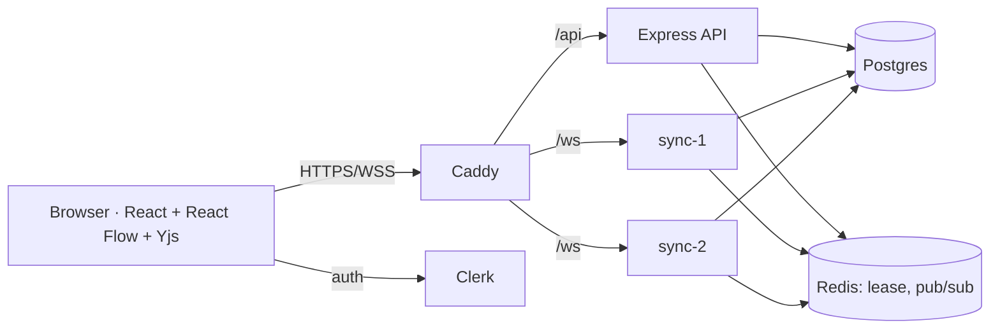

# ArchBoard

**A real-time whiteboard for system design interviews: one pen at a time.**

Draw architectures with real AWS, Google Cloud and Azure icons. Pass the pen between interviewer and candidate, run a phased interview timer, size the system with a built-in capacity calculator, and replay how the design evolved.

> **Live:** https://archboard.ashutoshdev.online · **Status:** the single-user editor works today (components, connections, groups, pen and shapes, capacity calculator); live collaboration, interview mode and replay are on the roadmap. See [docs/PLAN.md](docs/PLAN.md).
>
> **Board rules:** one board per person at a time, deleted automatically 7 days after it is created. Boards are stored in your browser.

## Why it's interesting

- **Pass the pen, enforced by the server.** Exactly one presenter edits; everyone else watches live. The sync server rejects document updates from anyone without the current Redis lease, so the client is never trusted.
- **Never lose work.** Yjs CRDT with IndexedDB offline storage, and a durable-ack protocol so "Saved" really means it's in Postgres.
- **One diagram format everywhere.** Templates, import/export, the clipboard and the (Phase 9) AI agent all share one Zod schema, property-tested against the live Y.Doc.
- **Accessible by default.** WCAG 2.1 AA chrome, keyboard-first, axe checks in CI at four viewports in both themes.

## Architecture



Full design: [docs/DESIGN.md](docs/DESIGN.md) · UX spec: [docs/UX.md](docs/UX.md) · Decisions: [docs/adr/](docs/adr/)

## Repository layout

| Path                      | What                                                                        |
| ------------------------- | --------------------------------------------------------------------------- |
| `apps/web`                | React + Vite SPA (served as static files by Caddy)                          |
| `apps/api`                | Express REST API                                                            |
| `apps/sync`               | WebSocket + Yjs sync server                                                 |
| `packages/diagram-schema` | DiagramV1 schema, Y.Doc converters, diagram operations, capacity calculator |
| `packages/protocol`       | Versioned WebSocket message schemas and close codes                         |
| `packages/db`             | Prisma schema, migrations, seed                                             |
| `packages/icons`          | Icon registry, search, vendor pack importer                                 |
| `packages/ui`             | Design tokens and components (Tailwind v4 + Radix)                          |
| `packages/shared`         | Errors, env loading, logging, storage                                       |
| `e2e`                     | Playwright end-to-end and accessibility tests                               |

## Deployment

Production is a single GCE VM running Caddy (automatic HTTPS) that serves the built SPA:

- `infra/vm/startup.sh` bootstraps the VM (Caddy, a locked-down `deploy` user, swap).
- `infra/caddy/Caddyfile` sets security headers (strict CSP, HSTS) and caching.
- `.github/workflows/deploy.yml` deploys after CI passes on `main`: build, upload, atomic symlink switch, smoke test. Run it manually with **rollback** to go back a release.
- Repository secrets: `VM_HOST` (static IP) and `VM_SSH_KEY` (deploy user key).

## Local development

Prerequisites: Node 22+, pnpm 9, Docker.

```bash
pnpm install                 # also generates the Prisma client
cp .env.example .env         # local defaults work as-is
pnpm dev:services            # Postgres + Redis in Docker (localhost only)
pnpm db:migrate              # apply migrations
pnpm db:seed                 # sample user and boards
pnpm --filter @archboard/icons build   # build the icon registry
pnpm dev                     # web app on http://localhost:5180
```

Open `http://localhost:5180/dev/ui` for the design-system gallery.

To run the API and sync server in Docker with hot reload as well:

```bash
docker compose -f infra/compose/compose.dev.yml --profile apps up
```

The first run builds a dev image with the dependencies inside it (about 1 minute). Only `src/` folders are mounted, so containers never touch your local `node_modules`. After changing dependencies, rebuild with `--build`.

Or run them on the host: `pnpm --filter @archboard/api dev` and `pnpm --filter @archboard/sync dev`.

### Checks

```bash
pnpm lint && pnpm typecheck && pnpm test   # all packages, via Turborepo
pnpm test:e2e                              # Playwright + axe at 4 viewports
# first time only: pnpm --filter @archboard/e2e exec playwright install chromium
```

### Icons

The 21 generic icons are ArchBoard's own. Official AWS, Azure and Google Cloud packs are **not committed**. `pnpm icons:import` downloads them from the URLs in `packages/icons/sources.json`, verifies a pinned SHA-256 and builds the registry. Licence terms and how we follow them: [docs/ICONS.md](docs/ICONS.md).

## Tech stack

TypeScript · React 19 · Vite · React Router · React Flow · Tailwind CSS v4 · Radix UI · Zustand · Yjs · Express 5 · ws · PostgreSQL 16 · Prisma 7 · Redis 7 · Clerk · Docker Compose · Caddy · Terraform · GCP · GitHub Actions · Vitest · Playwright · axe

## License

Source code: to be decided before the repository goes public. Vendor icons remain under their providers' terms.
