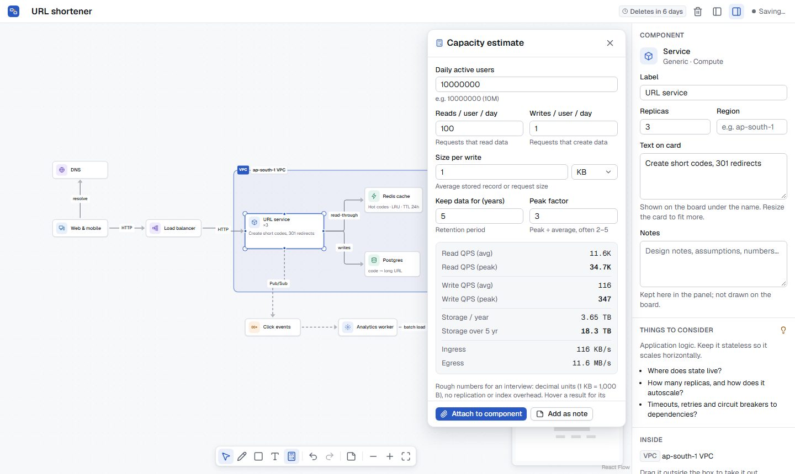
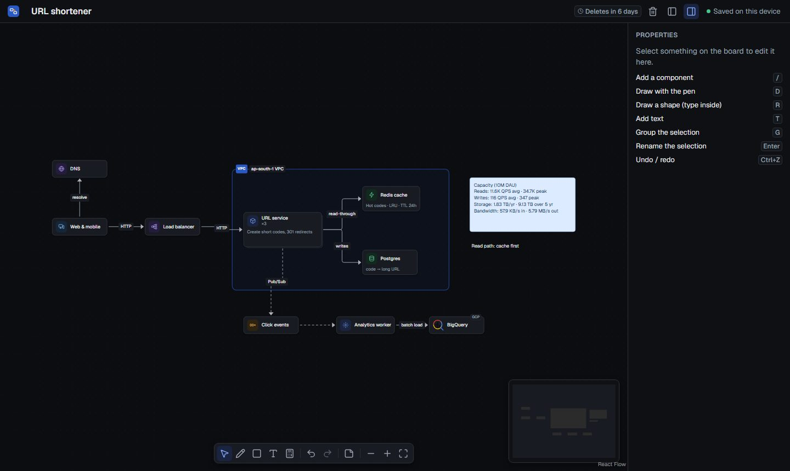
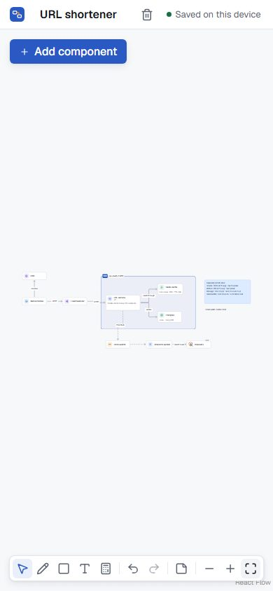
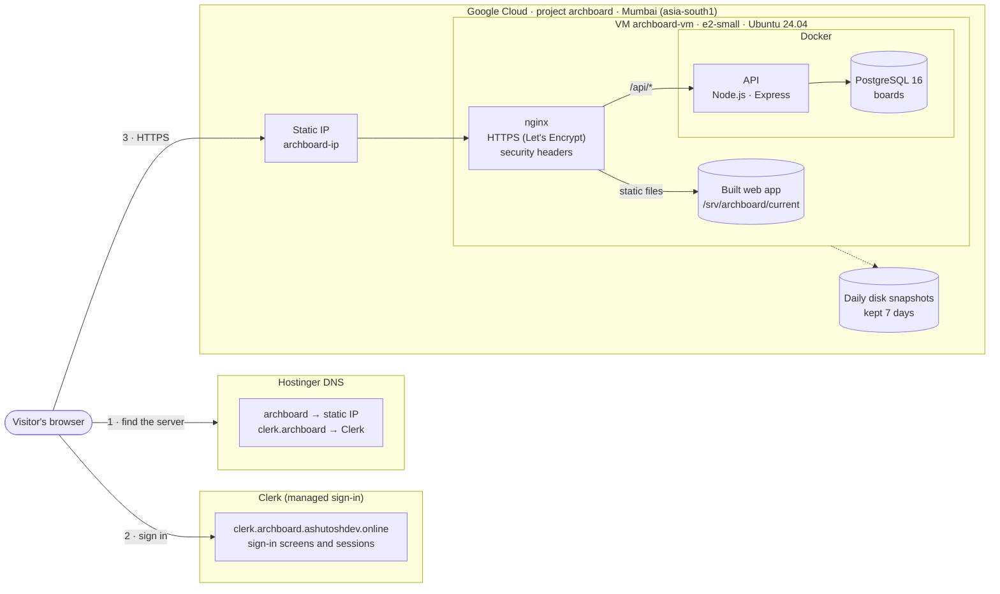
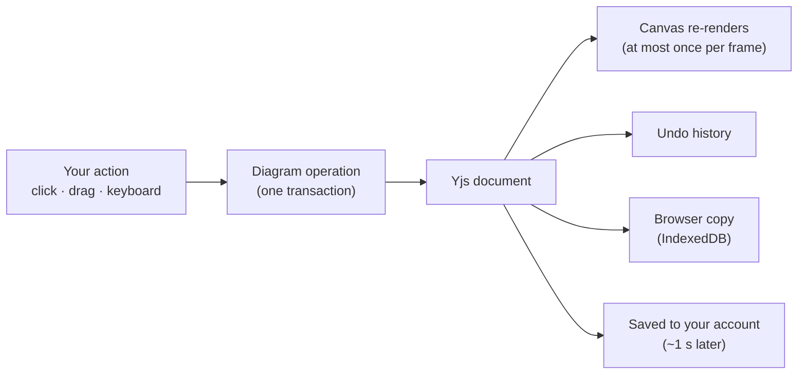
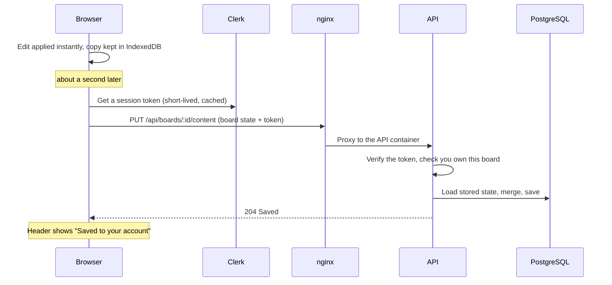
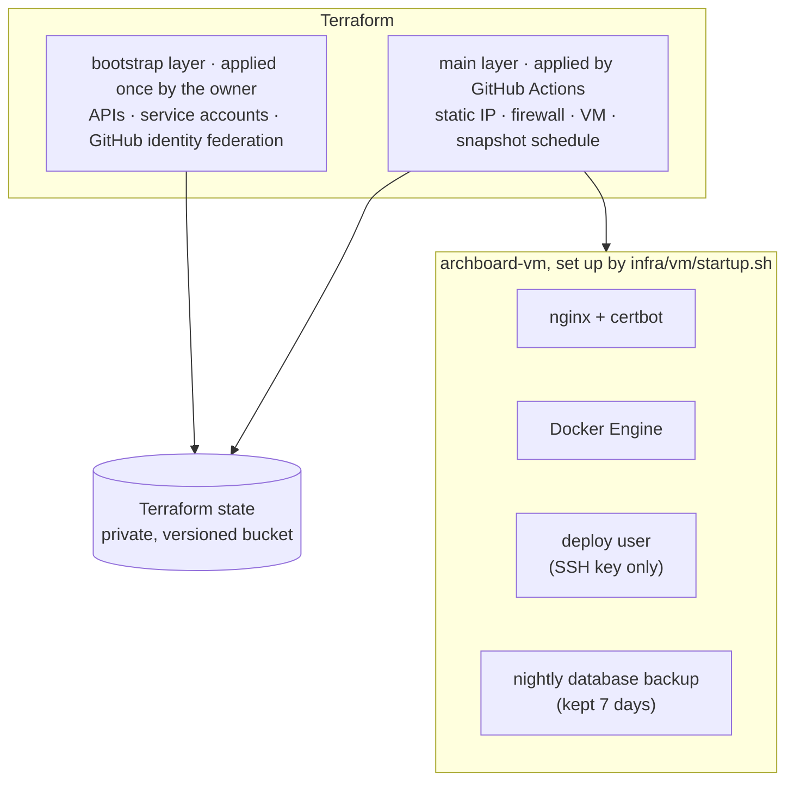
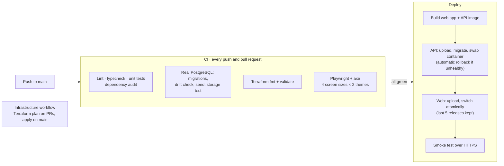

# ArchBoard

**The board built for system design interviews.**

Lay out real AWS, Google Cloud and Azure components, connect and group them, write details on every card, sketch with a pen, and size the system with a built-in capacity calculator. Sign in and your board is saved to your account.

**Live:** https://archboard.ashutoshdev.online


> **How boards work:** sign in (email or Google) and you get one board, kept for **7 days**. Only you can open it.

---

## Contents

1. [Features](#features)
2. [Architecture at a glance](#architecture-at-a-glance)
3. [What each technology is used for](#what-each-technology-is-used-for)
4. [How it works](#how-it-works)
5. [Hosting and infrastructure](#hosting-and-infrastructure)
6. [CI/CD](#cicd)
7. [Security](#security)
8. [Quality and testing](#quality-and-testing)
9. [Keyboard shortcuts](#keyboard-shortcuts)
10. [Local development](#local-development)
11. [Repository layout](#repository-layout)

---

## Features


### 1,193 official architecture icons, found by what you call them

Every **AWS** (303), **Azure** (643) and **Google Cloud** (226) architecture icon, plus **21 cloud-neutral blocks** (Load Balancer, Cache, Queue, SQL Database…).

- Search understands aliases: `lb`, `elb` and `load balancer` all find the load balancer, `postgres` finds SQL Database, and `pubsub` finds Pub/Sub.
- Generic blocks rank first, then the matching provider services, each labelled with its cloud.
- **Click** a component to add it next to the selected one, or **drag** it exactly where you want it.


### Connections that say something

- Drag between any two components to connect them.
- Each connection can be **sync (solid)** or **async (dashed)**, with a **protocol tag** (HTTP, gRPC, WebSocket, TCP, Pub/Sub), a label and arrows.


### Regions, VPCs and clusters

- Select components, press **G**, and pick **Region, Availability zone, VPC, Subnet, Kubernetes cluster** or **Boundary**.
- Drag a component onto a group to put it inside, or drag it out to remove it. Groups resize, rename and nest.

### Properties that only show what matters

The right-hand panel follows the selection. For components: label, replicas, region, text on the card and private notes. For connections: style, protocol and arrows. For several items: align and distribute. Every generic component also has a **"Things to consider"** card with the follow-up questions an interviewer is likely to ask (cache miss storms, queue ordering, hot partitions…).

### Back-of-the-envelope capacity estimation

Press **E**, enter daily active users, reads and writes per user, payload size, retention and peak factor, and get **QPS** (average and peak), **storage** and **bandwidth** live. Hover any number to see its formula. **Attach to component** writes the estimate onto a card, and **Add as note** drops it on the board.



### Pen, shapes, text and sticky notes

- **Pen (D):** freehand strokes in 6 inks and 3 widths, kept exactly as drawn.
- **Shape (R):** box, rounded box, circle, diamond, cylinder or hexagon, with text typed straight inside.
- **Text (T)** and **sticky notes (N)**.


### Copy, paste, duplicate, undo

**Ctrl+C / Ctrl+V** copy items (between boards too), **Ctrl+D** duplicates, and **Ctrl+Z** undoes any action. Every delete shows an **Undo** toast.

### Saved to your account, safe offline

Every change is kept in your browser instantly and saved to your account about a second later. If the connection drops, the header says so and everything is sent when you're back. Open the board on any device you sign in on.

### Desktop, tablet and phone, light and dark

| Dark theme                                              | Phone                                                                                                         |
| ------------------------------------------------------- | ------------------------------------------------------------------------------------------------------------- |
|  |  |

---

## Architecture at a glance



**In plain words:** your browser downloads the app from our server and signs you in with Clerk. It then talks to our API to load and save your board. The API checks who you are on every request and stores the board in PostgreSQL. Everything runs on one small Google Cloud VM behind nginx.

---

## What each technology is used for

| Layer                      | Technology                    | What it does here                                                                                                             |
| -------------------------- | ----------------------------- | ----------------------------------------------------------------------------------------------------------------------------- |
| **Web app**                | React 19, TypeScript, Vite    | The editor and landing page. Vite builds them into static files                                                               |
|                            | React Flow 12                 | The canvas: panning, zooming, nodes, connections, selection                                                                   |
|                            | Yjs                           | The board's data model. Every change is a small "update", and updates from different tabs merge without conflicts             |
|                            | IndexedDB (y-indexeddb)       | Keeps a copy of the board in the browser, so edits are never lost while offline                                               |
|                            | Tailwind CSS v4, Radix UI     | Design system: light/dark tokens, accessible menus, dialogs and tooltips                                                      |
|                            | Clerk React SDK               | Sign-in and sign-up pages on our own domain (`/sign-in`, `/sign-up`), user menu, and short-lived session tokens for API calls |
| **API**                    | Node.js 22, Express 5         | Board endpoints: create, load, save, delete                                                                                   |
|                            | @clerk/backend                | Verifies each request's session token with Clerk's public key, with no network call                                           |
|                            | Zod, Pino                     | Configuration checked at start-up; structured JSON logs with request ids                                                      |
| **Data**                   | PostgreSQL 16, Prisma 7       | One row per board: the owner's Clerk id, the board content (Yjs state) and its expiry date                                    |
| **Edge**                   | nginx                         | HTTPS, HTTP/2, security headers, caching of static files, and the `/api` reverse proxy                                        |
|                            | certbot (Let's Encrypt)       | Free TLS certificates, renewed automatically                                                                                  |
| **Hosting**                | Google Compute Engine         | One e2-small VM in Mumbai with a static IP                                                                                    |
|                            | Docker Compose                | Runs the API and PostgreSQL as containers, with health checks and restart policies                                            |
|                            | Hostinger DNS                 | Points `archboard.ashutoshdev.online` at the VM and `clerk.archboard…` at Clerk                                               |
| **Infrastructure as code** | Terraform                     | Creates the VM, static IP, firewall rules, snapshot schedule and CI identity                                                  |
| **CI/CD**                  | GitHub Actions                | Tests every change, applies Terraform, builds and deploys                                                                     |
|                            | Workload Identity Federation  | Lets GitHub Actions use Google Cloud with short-lived tokens, with no stored key                                              |
| **Testing**                | Vitest, fast-check, Supertest | Unit, property-based and API tests                                                                                            |
|                            | Playwright, axe-core          | End-to-end tests at 4 screen sizes, plus accessibility checks                                                                 |

---

## How it works

### The editor: one source of truth

The board lives in a **Yjs document**. The canvas never edits itself. Every action (add, connect, group, delete) is a small, unit-tested operation that changes the document in one transaction, and the canvas re-renders from the document.



That's why undo is exact (one action is one step), why a reload restores the board precisely, and why saving can never corrupt a board.

### Saving a board



**Why merge instead of overwrite?** If the board is open in two tabs, each tab sends its own changes. Yjs merges them on the server, so neither tab can wipe out the other's work.

**If a save fails** (offline, server restart), the browser retries with backoff and shows the status in the header. Nothing is lost, because the browser copy holds every change until the server confirms it.

### Board limits, enforced by the server

| Rule                                    | How it's enforced                                                                                              |
| --------------------------------------- | -------------------------------------------------------------------------------------------------------------- |
| Only signed-in users can create a board | Every API route needs a valid Clerk session token, and the app shows a sign-in screen first                    |
| One board per account                   | A **unique index** on the owner in PostgreSQL: even two simultaneous requests can't create two boards          |
| Deleted after 7 days                    | Each board has an `expiresAt` date. Expired boards are hidden at once, and an hourly job deletes them for good |
| Only you can open your board            | The API checks the owner on every request. Someone else's board id gets the same "not found" as a missing one  |

### The API

| Endpoint                                | What it does                                      |
| --------------------------------------- | ------------------------------------------------- |
| `GET /api/me/board`                     | Your board, if you have one                       |
| `POST /api/boards`                      | Create your board (`409` if you already have one) |
| `GET /api/boards/:id`                   | Board details (title, created, expires)           |
| `GET /api/boards/:id/content`           | The board's content                               |
| `PUT /api/boards/:id/content`           | Save changes (merged on the server)               |
| `DELETE /api/boards/:id`                | Delete your board                                 |
| `GET /api/health` · `/api/health/ready` | Liveness, and readiness (checks the database)     |

Errors use the standard `application/problem+json` format with a human-readable message, which the app shows as is.

### Icons

The vendor icon packs are downloaded from the official AWS, Azure and Google pages at build time, checked against a pinned SHA-256 hash, and turned into a search index. They're never committed to the repository. Terms of use: [docs/ICONS.md](docs/ICONS.md).

---

## Hosting and infrastructure

Everything lives in its own Google Cloud project (**archboard**) and is defined in Terraform ([infra/terraform](infra/terraform/README.md)).



| Resource                 | Details                                                                                     | Why                                                     |
| ------------------------ | ------------------------------------------------------------------------------------------- | ------------------------------------------------------- |
| VM `archboard-vm`        | e2-small (2 vCPU burst, 2 GB RAM), 20 GB disk, Ubuntu 24.04, Shielded VM                    | Enough for nginx, the API and PostgreSQL, with headroom |
| Static IP `archboard-ip` | Premium network tier                                                                        | DNS never changes, even if the VM is rebuilt            |
| Firewall                 | 80/443 open to everyone; 22 for the deploy key only (no password login)                     | Only what the site and deployments need                 |
| Snapshots                | Daily, kept 7 days                                                                          | Whole-disk recovery, on top of nightly database dumps   |
| Protection               | Deletion protection; the boot disk survives VM replacement; image updates never recreate it | A configuration mistake can't wipe the database         |

**What the VM runs:** nginx on the host serves the web app and proxies `/api` to the API container, which only the VM itself can reach. PostgreSQL runs in Docker with no public port. Its password is generated on the VM at first boot and never leaves it.

**Cost:** roughly US$20 a month (VM, IP and disk), covered by Google Cloud credits.

---

## CI/CD



- **Zero-downtime web releases:** each release goes into its own folder, and a symlink switch makes it live in one step.
- **Safe API releases:** database migrations run first. If the new container doesn't pass its health check within 90 seconds, the previous image is restored automatically.
- **One-click rollback:** run the Deploy workflow with _rollback_ ticked to restore the previous web release and API image.
- **Keyless cloud access:** the infrastructure workflow uses Workload Identity Federation. Only this repository can use it, and its service account can manage Compute Engine but can't change permissions.

**Configuration** lives in GitHub repository variables, all of them public values: the VM's IP, the Clerk publishable key, the Clerk JWT public key and the GCP identifiers. The only secret is `VM_SSH_KEY`, the deploy user's private key.

---

## Security

- **Authentication:** Clerk handles sign-in. The API checks each session token's signature, expiry and origin with Clerk's public key.
- **Authorisation:** every board request checks ownership, and other people's boards look exactly like missing ones.
- **Privacy:** only the Clerk user id is stored, never your email or name. Deleting a board deletes everything stored about it.
- **Transport:** HTTPS only, with HSTS and HTTP/2. `www` redirects to the main domain.
- **Browser hardening:** a strict Content-Security-Policy with no inline scripts (only our code and Clerk's sign-in scripts can run), `nosniff`, a strict referrer policy and `frame-ancestors 'none'`.
- **Input limits:** board content must be a valid Yjs document and is capped at 2 MB.
- **Least privilege:** the VM's deploy user can run exactly two root helpers: apply a validated nginx config, and deploy or roll back the API. CI's cloud identity can't grant itself permissions.
- **Supply chain:** exact dependency versions, a production dependency audit in CI, and icon packs verified by SHA-256.

---

## Quality and testing

| Layer          | Tools                                     | Covers                                                                                                                                                                                         |
| -------------- | ----------------------------------------- | ---------------------------------------------------------------------------------------------------------------------------------------------------------------------------------------------- |
| Unit           | Vitest, fast-check                        | Diagram operations, schema validation (1,000-case round-trip property test), capacity maths, icon search ranking, board policy                                                                 |
| API            | Supertest                                 | Sign-in required, one board per account, ownership checks, merging concurrent saves, invalid content, 7-day expiry, token checks (wrong origin, expired, forged)                               |
| Database       | Real PostgreSQL in CI                     | Migrations from scratch, no schema drift, idempotent seed, concurrent-create race                                                                                                              |
| End-to-end     | Playwright                                | Build, connect, rename and reload; undo; drag and drop; groups; properties; connection styles; pen fidelity; shapes and text; capacity calculator; landing page, at 375, 768, 1024 and 1440 px |
| Accessibility  | axe-core                                  | No serious or critical WCAG 2.1 AA violations, in light and dark                                                                                                                               |
| Infrastructure | Terraform validate, `bash -n`, `nginx -t` | Both Terraform layers, every shell script, and the nginx config before every reload                                                                                                            |

---

## Keyboard shortcuts

| Action                          | Keys                                     |
| ------------------------------- | ---------------------------------------- |
| Search components               | `/`                                      |
| Select · Pen · Shape · Text     | `V` · `D` · `R` · `T` (`O` for a circle) |
| Sticky note · Capacity estimate | `N` · `E`                                |
| Group · Ungroup                 | `G` then `1–6` · `Shift+G`               |
| Copy · Paste · Duplicate        | `Ctrl+C` · `Ctrl+V` · `Ctrl+D`           |
| Undo · Redo                     | `Ctrl+Z` · `Ctrl+Shift+Z`                |
| Rename · Delete                 | `Enter` · `Delete`                       |
| Toggle side panels              | `[` · `]`                                |
| Back out                        | `Esc`                                    |

---

## Local development

Prerequisites: Node 22, pnpm 9, Docker.

```bash
pnpm install
cp .env.example .env
pnpm --filter @archboard/icons build   # cloud-neutral icons (all vendor packs: pnpm icons:import)
pnpm dev                               # http://localhost:5180
```

Without Clerk keys, the editor runs in **browser-only mode**: no sign-in, and the board is kept in your browser. To run the API too:

```bash
pnpm dev:services                      # PostgreSQL in Docker (localhost only)
pnpm db:migrate && pnpm db:seed
pnpm --filter @archboard/api dev       # needs CLERK_JWT_KEY in .env
```

Checks:

```bash
pnpm lint && pnpm typecheck && pnpm test
pnpm test:e2e
```

---

## Repository layout

```
apps/
  web/              React app: landing page, editor, sign-in
  api/              Express API: board storage, auth, expiry job
packages/
  diagram-schema/   Board format, Yjs conversion, diagram operations, capacity maths
  db/               Prisma schema, migration, seed
  icons/            Icon registry, search, vendor pack importer
  ui/               Design tokens and components
  shared/           Errors, config loading, logging
  config/           TypeScript, ESLint and Prettier presets
infra/
  terraform/        Google Cloud infrastructure (bootstrap + main layers)
  vm/               VM start-up script (nginx, certbot, Docker, deploy user, backups)
  nginx/            Production nginx config and security headers
  docker/           Production API image
  stack/            Production Docker Compose (API + PostgreSQL)
  scripts/          Deploy and rollback
  compose/          Local development stack
e2e/                Playwright end-to-end and accessibility tests
docs/               Icon terms, architecture decision records, screenshots
```

Design decisions: [Yjs vs OT](docs/adr/001-yjs-vs-ot.md) · [PostgreSQL vs MongoDB](docs/adr/003-postgres-vs-mongodb.md) · [React Flow vs a custom canvas](docs/adr/006-react-flow-vs-custom-canvas.md).

---

Built by Ashutosh Lodha. AWS, Google Cloud and Azure icons are trademarks of their respective owners, used under their published terms ([docs/ICONS.md](docs/ICONS.md)).
