# ArchBoard

**The whiteboard built for system design interviews.**

Drag in real AWS, Google Cloud and Azure components, wire them up, group them into regions and VPCs, write details on every card, sketch with a pen, and size the system with a built-in capacity calculator, all in your browser.

**Live:** https://archboard.ashutoshdev.online · **Docs:** [Design](docs/DESIGN.md) · [UX spec](docs/UX.md) · [Plan](docs/PLAN.md) · [Decisions](docs/adr/)

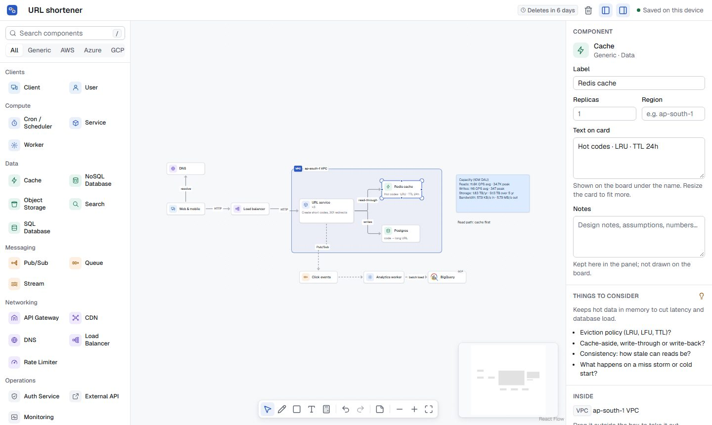

> **Board rules:** one board per person at a time, deleted automatically **7 days** after it's created. Boards are saved in your browser. No account is needed.

---

## Contents

- [Features](#features)
- [How it works](#how-it-works)
  - [System overview](#system-overview)
  - [Frontend architecture](#frontend-architecture)
  - [The diagram format](#the-diagram-format)
  - [Icon pipeline](#icon-pipeline)
  - [Backend](#backend)
  - [Planned: real-time collaboration](#planned-real-time-collaboration-pass-the-pen)
- [Deployment and CI/CD](#deployment-and-cicd)
- [Quality and testing](#quality-and-testing)
- [Keyboard shortcuts](#keyboard-shortcuts)
- [Local development](#local-development)
- [Repository layout](#repository-layout)
- [Roadmap](#roadmap)

---

## Features

### 1,193 official architecture icons, found by what you call them

The component panel has every **AWS** (303), **Azure** (643) and **Google Cloud** (226) architecture icon, plus **21 cloud-neutral blocks** drawn for ArchBoard (Load Balancer, Cache, Queue, SQL Database…).

- Search understands aliases: `lb`, `elb` and `load balancer` all find the load balancer, `postgres` finds SQL Database, and `pubsub` finds Google Pub/Sub.
- Generic blocks rank first, then the matching provider services, each labelled with its cloud.
- Tabs filter by provider, and recently used components stay on top.
- **Click** a component to add it, or **drag** it exactly where you want it.
- Click-added components chain left to right from the selected one, never overlap, and stay in view.

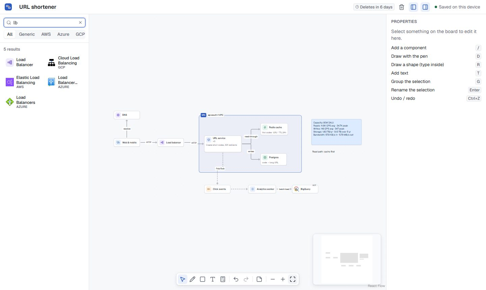

### Connections that say something

- Hover a component to reveal four connection points, then drag to another component to connect them.
- Every connection can be **sync (solid)** or **async (dashed)**.
- Add a **protocol tag** (HTTP, gRPC, WebSocket, TCP, Pub/Sub), a label like "writes", and arrows (one way, both or none).
- Routing is clean and orthogonal, and labels sit on a background pill so they stay readable.

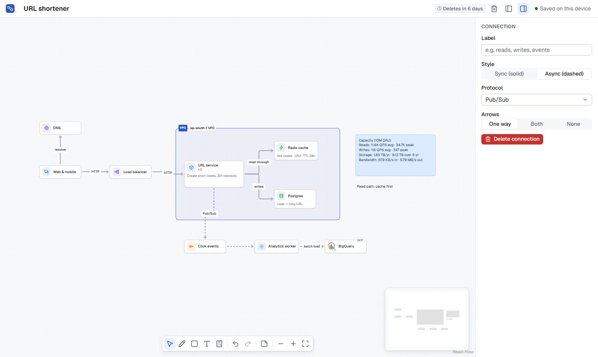

### Regions, VPCs and clusters

- Select components and press **G**, then pick a container type: **Region, Availability zone, VPC, Subnet, Kubernetes cluster** or **Boundary** (keys 1–6).
- Drag a component onto a group to put it inside; the group lights up as you hover. Drag it out to remove it.
- Groups resize, rename and nest. **Shift+G** ungroups.
- Positions are kept relative to the container, so moving a VPC moves everything in it.

### A properties panel that only shows what matters

The right-hand panel changes with the selection:

- **A component:** label, replicas (shown as a stacked card with ×3), region, **text on the card**, and private notes.
- **A connection:** label, style, protocol, arrows.
- **A group:** name, type, ungroup.
- **Notes, shapes, text and drawings:** colour, shape type, size, ink.
- **A multi-selection:** align (6 ways), distribute, group.

For every generic component there's a **"Things to consider"** card with the questions an interviewer is likely to ask: cache eviction and miss storms, queue ordering and dead-letter handling, NoSQL hot partitions, rate-limiter placement, and so on.

### Back-of-the-envelope capacity estimation

Press **E**. Enter daily active users, reads and writes per user, payload size, retention and peak factor. ArchBoard shows:

- average and peak **read/write QPS**
- **storage** per year and over the retention period
- **ingress and egress bandwidth**

Hover any number to see its formula. The inputs are saved with the board. **Attach to component** writes the estimate onto the selected card; **Add as note** drops it on the board.


### Sketch freely: pen, shapes, text and sticky notes

- **Pen (D):** freehand strokes in 6 inks and 3 widths. It stays on until you press Esc, and strokes keep exactly the shape you drew.
- **Shape (R):** drag to draw a box, rounded box, circle, diamond, cylinder or hexagon, and start typing inside straight away.
- **Text box (T):** click and type.
- **Sticky notes (N):** in five colours, resizable.

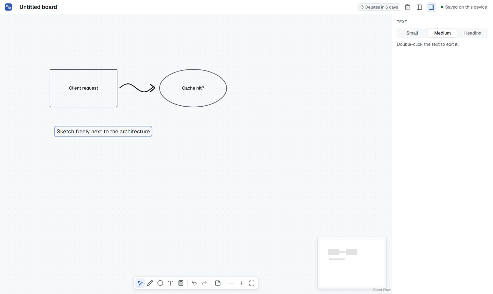

### Resizable component cards with text

Components aren't just icons. Resize any card and write details on it ("L7, TLS termination, health checks every 5s"), right on the board, using **+ Add text**, a double-click or the properties panel.

### Never lose work

- Every change **autosaves** to your browser (IndexedDB). The header shows "Saving…" and then "Saved on this device".
- **Undo/redo** covers every action, and each action is exactly one step.
- A **Delete** shows an **Undo** toast. Each toast is tied to its own delete, so it can never undo something else.
- Reloading restores the board exactly, and an existing board opens zoomed to fit.

### Works on desktop, tablet and phone, in light and dark

- On desktop, both side panels are collapsible with **[** and **]**.
- On tablets the panels become drawers; on phones they become bottom sheets with large touch targets.
- The light and dark themes are both checked for WCAG AA contrast.

| Dark theme                                              | Phone                                                                                                         |
| ------------------------------------------------------- | ------------------------------------------------------------------------------------------------------------- |
|  |  |

### Clear, simple rules

- **One board per person.** Starting another asks before deleting the current one.
- **Deleted after 7 days.** A badge on the board counts down the days left.
- **Saved in your browser:** nothing is uploaded, and clearing site data deletes the board.
- Opening a board that has expired explains what happened.

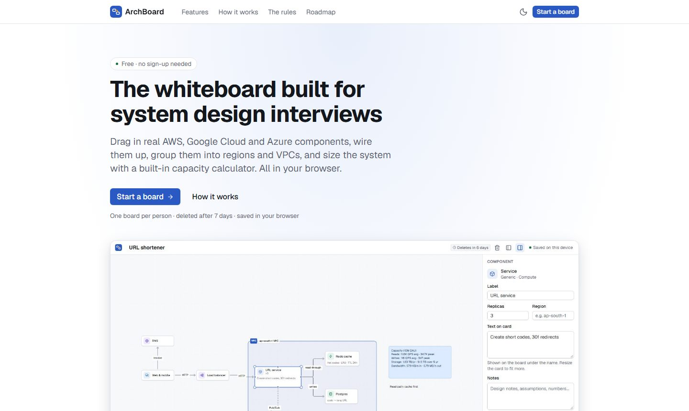

---

## How it works

### System overview

What runs in production **today**, and the services that are built and tested but not deployed yet:

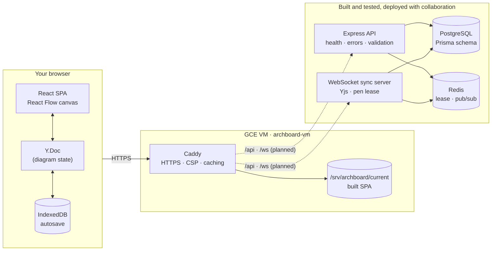

Boards are local-first. The whole editor runs in the browser, and the VM only serves static files. This keeps the live site fast and cheap, and means a server problem can never lose your board. The API and sync server plug in behind the same Caddy, on the same domain, when collaboration ships.

### Frontend architecture

**Stack:** React 19, Vite, React Router, React Flow 12, Yjs, Tailwind CSS v4, and Radix UI (through our own design system in `packages/ui`), all in strict TypeScript.

The key idea: **the Y.Doc is the single source of truth. React Flow only renders it.**

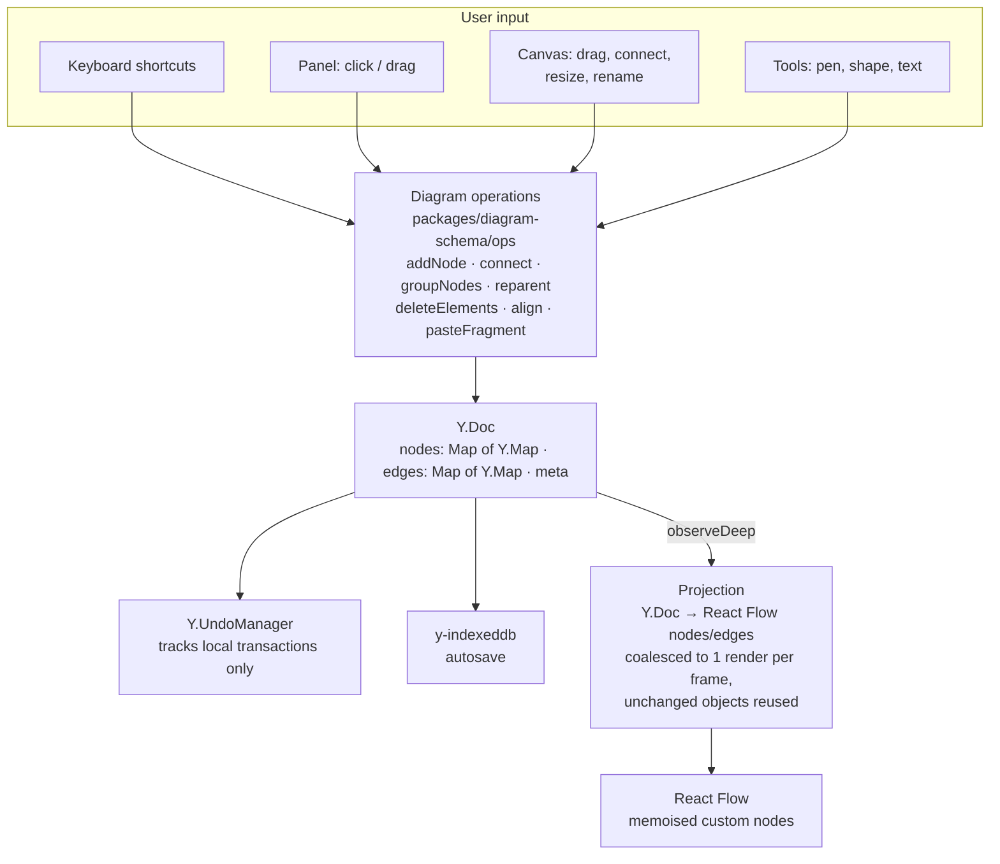

- **Every change goes through a pure, unit-tested operation** in `packages/diagram-schema`, in a single Yjs transaction. One action means one undo step and, later, one network update.
- **Drags stay local** while you move and write to the document once, on drop. That keeps undo clean and avoids flooding the update log.
- **The projection** turns the Y.Doc into React Flow's arrays. It batches bursts of changes into one render per animation frame and reuses unchanged node objects, so memoised components don't re-render. It also merges in local-only state such as selection and measured sizes.
- **The Y.Doc layout** uses field-level maps (`nodes: Map<id, Map<field, value>>`). That's ready for collaboration, where concurrent edits to different fields merge cleanly.

How a save works:

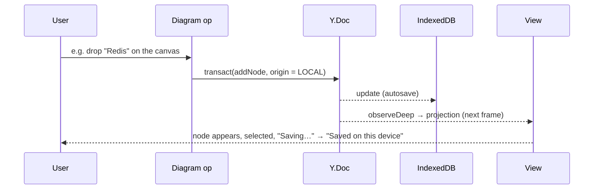

### The diagram format

One schema, `DiagramV1` in `packages/diagram-schema`, defined with Zod. It's used for templates, JSON import/export, the clipboard and the planned AI generator. Validation reports problems with exact paths, like _"Edge 3 points to a missing node 'db-1'"_. Converting to and from the Y.Doc is **property-tested on 1,000 random diagrams**.

```ts
{
  format: 'archboard.diagram', version: 1,
  meta: { title: 'URL shortener' },
  nodes: [
    { id: 'api', kind: 'component', iconId: 'generic/service', label: 'URL service',
      parentId: 'vpc', position: { x: 32, y: 120 }, size: { width: 216, height: 96 },
      data: { replicas: 3, description: 'Create short codes, 301 redirects' } },
    { id: 'vpc', kind: 'group', groupType: 'vpc', label: 'ap-south-1 VPC', … },
    // also: note, text, shape (6 kinds), drawing (pen strokes)
  ],
  edges: [
    { id: 'e5', source: 'api', target: 'queue', style: 'async', protocol: 'pubsub', arrow: 'end' },
  ],
}
```

### Icon pipeline

Vendor icon packs are **never committed**. A script downloads them from the official pages, verifies a **pinned SHA-256**, and builds a normalised registry that both the search and the planned AI generator use.

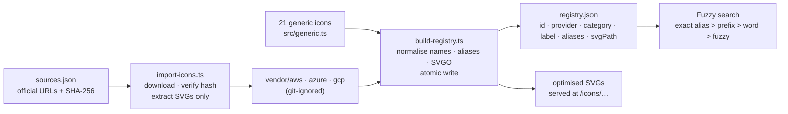

Names keep each vendor's own casing ("AWS IoT SiteWise", "AKS Automatic", "Pub/Sub"). The terms of use for each pack, and how ArchBoard follows them, are in [docs/ICONS.md](docs/ICONS.md).

### Backend

The backend for collaboration is built as tested foundations, ready for the features that need it. Each service follows twelve-factor rules (configuration from the environment, validated at start-up; stateless processes; graceful shutdown).

| Service                                             | What exists today                                                                                                                                                                                                                      | Tests                  |
| --------------------------------------------------- | -------------------------------------------------------------------------------------------------------------------------------------------------------------------------------------------------------------------------------------- | ---------------------- |
| **API** (`apps/api`, Express 5)                     | App factory; liveness `/api/health` and readiness `/api/health/ready` (checks Postgres and Redis with a 2 s timeout); request ids; Helmet security headers; RFC 9457 `problem+json` errors that never leak internals; JSON size limits | 8                      |
| **Sync server** (`apps/sync`, `ws` + Yjs)           | Health endpoints; Origin check on WebSocket upgrade; board-room routing; WebSocket echo for uptime monitors; clean "try again" close on shutdown                                                                                       | 6                      |
| **Database** (`packages/db`, PostgreSQL + Prisma 7) | Full schema: users, boards, members, invites, guests, an append-only Yjs update log, snapshots, replay events, comments, interview sessions, templates, AI jobs. Versioned migration; idempotent seed; CI fails on schema drift        | migration + seed in CI |
| **Protocol** (`packages/protocol`)                  | Versioned WebSocket messages validated with Zod on both ends, binary message ids, close codes, and the exact UI text for each failure                                                                                                  | 11                     |

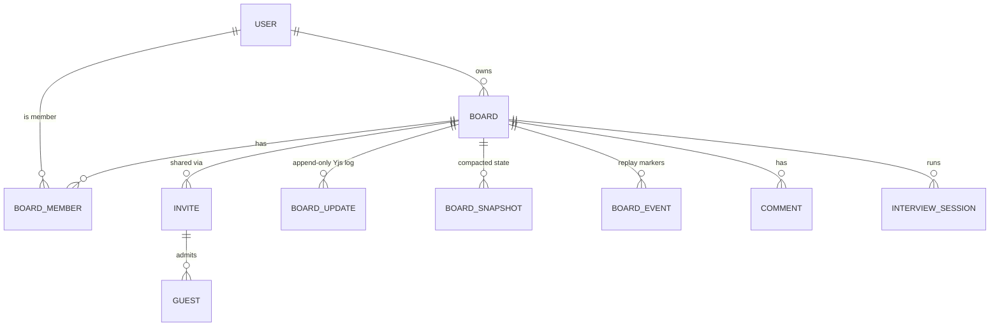

### Planned: real-time collaboration ("pass the pen")

Exactly one presenter edits at a time while everyone else watches live, comments and points. The pen is a **lease in Redis** (`SET room:{id}:pen … NX PX 15000`), renewed by the presenter's heartbeat. **The sync server rejects document updates from anyone who doesn't hold the lease**, so the client is never trusted. If the presenter disconnects, the lease expires and the pen returns to the owner.

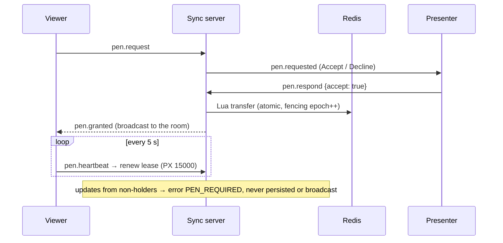

The full design (durable write acks, multi-instance fan-out over Redis pub/sub, replay and compaction) is in [docs/DESIGN.md](docs/DESIGN.md).

---

## Deployment and CI/CD

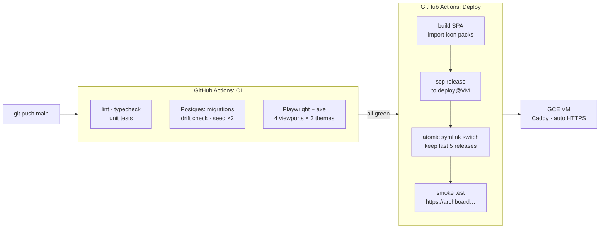

- **The VM** (`infra/vm/startup.sh`) installs Caddy and sets up a `deploy` user with no sudo except one helper: validate a new Caddy config and apply it only if it's valid. It also adds swap and unattended security upgrades.
- **Caddy** (`infra/caddy/Caddyfile`) provides automatic Let's Encrypt certificates, a strict **Content-Security-Policy** with no inline scripts, HSTS and other security headers, immutable caching for hashed assets, and the single-page-app fallback.
- **Releases are atomic.** Each one is unpacked into its own folder, and a symlink switch makes it live with no half-deployed state. **Rollback:** run the Deploy workflow with `rollback` (`infra/scripts/rollback-web.sh`).
- **Secrets** (`VM_HOST`, `VM_SSH_KEY`) live in GitHub's encrypted secrets. Nothing secret is in the repository; see `.env.example`.

---

## Quality and testing

| Layer         | Tooling             | What's covered                                                                                                                                                                                                                                                                                                                                                                     |
| ------------- | ------------------- | ---------------------------------------------------------------------------------------------------------------------------------------------------------------------------------------------------------------------------------------------------------------------------------------------------------------------------------------------------------------------------------- |
| Unit          | Vitest, fast-check  | Diagram ops (grouping keeps on-screen positions, cascading delete, paste remapping, align/distribute, undo integration), schema validation with path-specific errors, 1,000-case round-trip property test, capacity maths against hand-computed values, icon search ranking on the real packs, board policy (create, one-at-a-time, expiry), protocol parsing, storage path safety |
| API           | Supertest           | Health/readiness, timeouts, security headers, problem+json errors, no leaked internals                                                                                                                                                                                                                                                                                             |
| End-to-end    | Playwright          | Every core journey at **375, 768, 1024 and 1440 px**: build LB → Service → DB and connect, rename, reload; undo from the keyboard and from the toast; drag from the panel; groups and drag in/out; properties; connection styles; pen fidelity (saved stroke equals the live preview within 2 px); shapes and text; capacity calculator; Google Cloud search; landing page         |
| Accessibility | axe-core            | 0 serious/critical WCAG 2.1 AA violations on the landing page, the board and the design system, in light and dark; keyboard reachability                                                                                                                                                                                                                                           |
| Database      | Real Postgres in CI | Migrations from scratch, no schema drift, idempotent seed                                                                                                                                                                                                                                                                                                                          |
| Supply chain  | `pnpm audit`        | Production dependencies clean; versions pinned exactly                                                                                                                                                                                                                                                                                                                             |

**Totals:** 126 unit/API tests and 78 end-to-end checks, all green.

---

## Keyboard shortcuts

| Action                             | Keys                                          |
| ---------------------------------- | --------------------------------------------- |
| Search components                  | `/`                                           |
| Select · Pen · Shape · Text box    | `V` · `D` · `R` · `T` (`O` jumps to a circle) |
| Sticky note                        | `N`                                           |
| Capacity estimate                  | `E`                                           |
| Group · Ungroup                    | `G` then `1–6` · `Shift+G`                    |
| Rename selection                   | `Enter` / `F2`                                |
| Delete                             | `Delete` / `Backspace` (undoable)             |
| Undo · Redo                        | `Ctrl+Z` · `Ctrl+Shift+Z` (or `Ctrl+Y`)       |
| Multi-select                       | `Shift`-click or drag a box                   |
| Toggle side panels                 | `[` · `]`                                     |
| Back out (menu → tool → selection) | `Esc`                                         |

---

## Local development

Prerequisites: Node 22+, pnpm 9, Docker.

```bash
pnpm install                          # also generates the Prisma client
cp .env.example .env                  # local defaults work as-is
pnpm --filter @archboard/icons build  # generic icons (add vendor packs: pnpm icons:import)
pnpm dev                              # web app on http://localhost:5180
```

The editor works with just that. To run the backend services too:

```bash
pnpm dev:services        # Postgres + Redis in Docker (localhost only)
pnpm db:migrate && pnpm db:seed
docker compose -f infra/compose/compose.dev.yml --profile apps up   # API + sync with hot reload
```

The Docker dev image keeps dependencies inside the image and mounts only `src/` folders, so containers never touch your local `node_modules`.

Checks:

```bash
pnpm lint && pnpm typecheck && pnpm test   # everything, via Turborepo
pnpm test:e2e                              # Playwright + axe (first time: pnpm --filter @archboard/e2e exec playwright install chromium)
```

---

## Repository layout

```
apps/
  web/     React SPA: landing page, editor (board/), routes
  api/     Express REST API
  sync/    WebSocket + Yjs sync server
packages/
  diagram-schema/  DiagramV1 schema, Y.Doc converters, diagram operations, capacity maths
  protocol/        versioned WebSocket messages and close codes
  db/              Prisma schema, migrations, seed
  icons/           icon registry, search, vendor pack importer
  ui/              design tokens and components (Tailwind v4 + Radix)
  shared/          errors, env loading, logging, storage
  config/          TypeScript, ESLint and Prettier presets
infra/
  caddy/  vm/  scripts/  compose/      production edge, VM bootstrap, deploy/rollback, dev stack
e2e/       Playwright end-to-end and accessibility tests
docs/      design, UX spec, plan, ADRs, icon terms, reviews
```

---

## Roadmap

| Status | Feature                                                                                                   |
| ------ | --------------------------------------------------------------------------------------------------------- |
| ✅     | Editor: components, connections, groups, properties, pen/shapes/text, capacity calculator, autosave, undo |
| ✅     | 1,193 official AWS / Azure / Google Cloud icons with alias search                                         |
| ✅     | Landing page, production deployment pipeline, CI/CD                                                       |
| ⏳     | Sign-in, sharing, and boards stored on the server                                                         |
| ⏳     | **Pass the pen:** live collaboration with a server-enforced presenter lease                               |
| ⏳     | Interview mode: phased timer, requirements checklist, roles                                               |
| ⏳     | Session replay, templates, PNG/SVG export, JSON import                                                    |
| ⏳     | Generate a diagram from a prompt (LLM with structured output and auto-layout)                             |

Design decisions are recorded as ADRs: [Yjs vs OT](docs/adr/001-yjs-vs-ot.md) · [Postgres vs MongoDB](docs/adr/003-postgres-vs-mongodb.md) · [React Flow vs a custom canvas](docs/adr/006-react-flow-vs-custom-canvas.md).

---

Built by Ashutosh Lodha. AWS, Google Cloud and Azure icons are trademarks of their respective owners and are used under their published terms ([docs/ICONS.md](docs/ICONS.md)).
