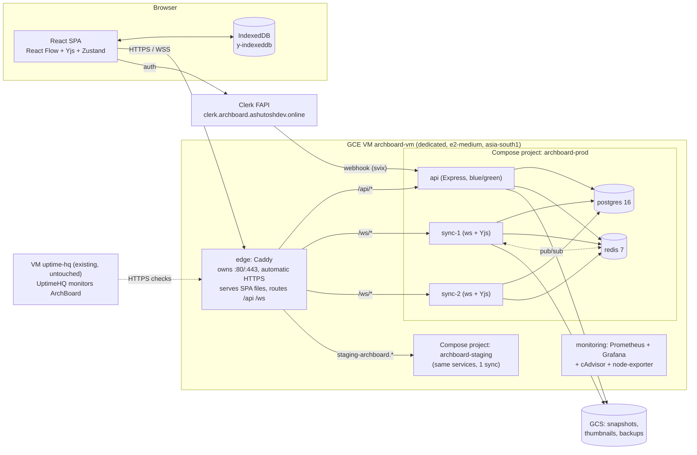
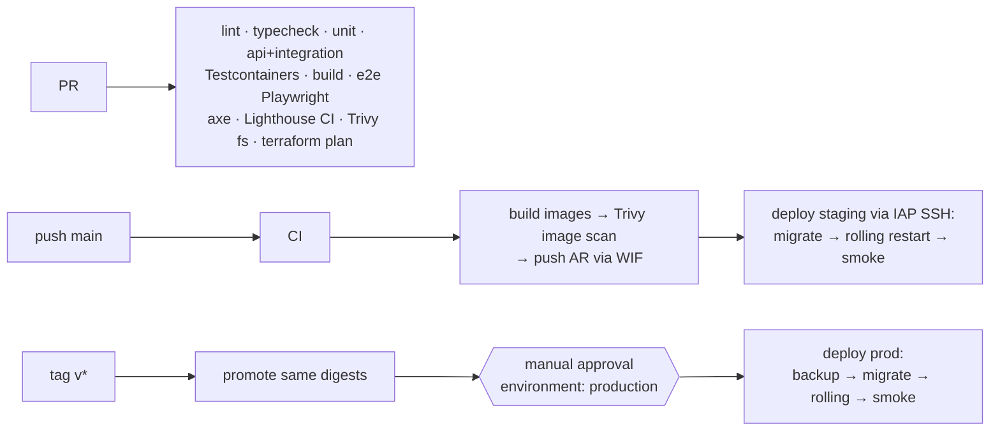

# ArchBoard — Technical Design

Status: **Draft v1 — awaiting approval** · Last updated: 2026-11-21

This document is the engineering source of truth. UX decisions live in [UX.md](UX.md), delivery in [PLAN.md](PLAN.md). Items marked **[DECISION]** need sign-off; items marked **[VERIFY]** depend on facts I could not check from here.

---

## 1. Goals and non-goals

**Goals (in priority order):** usability → reliability (no lost work) → responsive performance → backend/DevOps depth → docs.

**Non-goals for MVP:**
- Simultaneous multi-editor editing (pass-the-pen is a deliberate product choice, see ADR-002).
- Native mobile apps, offline-first *multi-user* boards, video/voice. (Freehand pen drawing, basic shapes and text boxes were added on request in Phase 2 — see §4: `shape` and `drawing` node kinds.)
- Running on anything other than a single VM (but stay 12-factor so Cloud Run/GKE is a lift, not a rewrite).

---

## 2. System overview



### 2.1 Why this shape
- **ArchBoard gets its own VM.** UptimeHQ's VM is not changed in any way: no nginx edits, no shared Docker network, no resize, no maintenance window. The two apps live in separate failure domains and can monitor each other (§9.10). The tradeoff analysis is in §9.1.
- **One origin.** `/` (SPA), `/api/*` and `/ws/*` all served from `archboard.ashutoshdev.online`. No CORS, cookies are first-party, CSP is simple.
- **Caddy is the edge**, as in the original spec: it owns 80/443, gets and renews certificates automatically, serves the static SPA, routes `/api` and `/ws`, and sets security headers. There is no certbot and no cron.
- **Two sync replicas in prod** from day one, so Redis pub/sub fan-out is exercised in production, not just in tests.
- **Prod, staging and monitoring all fit on one 4 GB VM** with headroom (§9.4), so staging can stay running.

---

## 3. Monorepo layout

```
archboard/
├─ apps/
│  ├─ web/            React + Vite SPA (routes: landing, dashboard, board, replay, join)
│  ├─ api/            Express REST API + Clerk webhook (+ Phase 9 AI job worker entry)
│  └─ sync/           ws + Yjs server: rooms, auth, pen lease, awareness, persistence
├─ packages/
│  ├─ diagram-schema/ Zod schema for DiagramV1 + Y.Doc <-> JSON converters + diagram ops
│  ├─ protocol/       WebSocket control-message schemas (Zod), versioned, shared web/sync
│  ├─ icons/          normalised icon registry + import script + search index builder
│  ├─ db/             Prisma schema, migrations, client singleton, seed
│  ├─ ui/             design tokens + shadcn/Radix components + Clerk appearance theme
│  ├─ shared/         errors, logger (pino), env parsing (Zod), storage interface, ids
│  └─ config/         eslint, prettier, tsconfig bases
├─ infra/
│  ├─ compose/        compose.dev.yml, compose.prod.yml, Caddyfile, postgres.conf
│  ├─ caddy/          edge Caddyfile (prod + staging + security headers)
│  ├─ cloud-init/     VM bootstrap template
│  ├─ terraform/      GCP resources (see §9.6)
│  └─ scripts/        deploy.sh, rollback.sh, backup.sh, restore.sh
├─ e2e/               Playwright tests + visual baselines
├─ load/              k6 scripts
└─ docs/              DESIGN, UX, PLAN, ICONS, PERFORMANCE, LOAD_TEST, RUNBOOK, THREAT_MODEL, adr/
```

Tooling: pnpm 9 workspaces, Turborepo, Node 22 LTS, TypeScript 5.x strict (`noUncheckedIndexedAccess`, `exactOptionalPropertyTypes`). Versions are pinned exactly (no `^`) and Renovate is configured but its PRs are grouped weekly.

Why a separate `packages/protocol`: the control-message schema changes at a different pace than the diagram schema, and both web and sync must agree byte-for-byte.

---

## 4. Diagram format (`packages/diagram-schema`)

There is **one format** for templates, JSON import/export, clipboard payloads and AI output. The live board is a Y.Doc, and converters go both ways (`toYDoc`, `fromYDoc`). Round-tripping is property-tested.

```ts
// Simplified; the real file uses Zod with refinements.
export const DiagramV1 = z.object({
  format: z.literal('archboard.diagram'),
  version: z.literal(1),
  meta: z.object({ title: z.string().max(120), description: z.string().max(2000).optional() }),
  nodes: z.array(Node).max(2000),
  edges: z.array(Edge).max(4000),
});

const NodeBase = {
  id: Id,                                   // nanoid(10), unique per doc
  position: z.object({ x: z.number().finite(), y: z.number().finite() }), // relative to parent if parentId
  parentId: Id.optional(),                  // must reference a 'group' node; no cycles
  zIndex: z.number().int().optional(),
};
const Node = z.discriminatedUnion('kind', [
  z.object({ ...NodeBase, kind: z.literal('component'),
    iconId: IconId,                         // must exist in packages/icons registry
    label: z.string().min(1).max(80),
    data: z.object({ replicas: z.number().int().min(1).max(10_000).optional(),
                     region: z.string().max(40).optional(),
                     notes: z.string().max(4000).optional(),
                     capacity: CapacityResult.optional() }).default({}) }),
  z.object({ ...NodeBase, kind: z.literal('group'),
    groupType: z.enum(['region','az','vpc','subnet','k8s','boundary']),
    label: z.string().max(80), size: Size }),
  z.object({ ...NodeBase, kind: z.literal('note'),  text: z.string().max(4000), color: NoteColor, size: Size }),
  z.object({ ...NodeBase, kind: z.literal('text'),  text: z.string().max(2000), fontSize: z.enum(['s','m','l']) }),
]);

const Edge = z.object({
  id: Id, source: Id, target: Id,
  sourceHandle: Handle.optional(), targetHandle: Handle.optional(), // 'top'|'right'|'bottom'|'left'
  label: z.string().max(80).optional(),
  style: z.enum(['sync','async']).default('sync'),                 // solid | dashed
  protocol: z.enum(['http','grpc','websocket','tcp','pubsub']).optional(),
  arrow: z.enum(['end','both','none']).default('end'),
});
```

Cross-field validation (`superRefine`): every edge endpoint exists, every `parentId` is a group, no parent cycles, ids are unique, `iconId` is in the registry. Error messages carry JSON paths so import errors can say "Edge 3 points to a missing node 'db-1'".

### 4.1 Y.Doc layout

```
Y.Doc
├─ nodes : Y.Map<nodeId, Y.Map<field, value>>   // field-level maps → concurrent field edits merge cleanly
├─ edges : Y.Map<edgeId, Y.Map<field, value>>
└─ meta  : Y.Map  { title, schemaVersion: 1 }
```
- Positions are stored as one `{x,y}` value (not separate x/y) so a drag never produces a torn position.
- Drags are written **throttled to one transaction per animation frame**, with a final write on drag end. This keeps viewers smooth without flooding the log.
- Interview state, comments and the pen are **not** in the Y.Doc. They have different write permissions from the diagram (see §6.4).

### 4.2 Diagram operations
Pure functions in `diagram-schema/ops`, used by the UI, templates, import and the AI applier: `addNode`, `connect`, `group`/`ungroup` (recomputes relative positions), `align`/`distribute`, `duplicate` (remaps ids), `pasteAt`, `deleteSelection` (cascades to edges and children), `autoName` ("Service 1", "Service 2", …), and `findFreeSpot` (spiral search so new nodes never overlap). These are 100% unit-tested and are the only code that mutates the Y.Doc.

---

## 5. Data model (Prisma draft, `packages/db/schema.prisma`)

```prisma
generator client { provider = "prisma-client-js" }
datasource db { provider = "postgresql"; url = env("DATABASE_URL") }

enum MemberRole   { OWNER EDITOR VIEWER }        // EDITOR = "can request the pen"
enum InviteRole   { EDITOR VIEWER }
enum EventType    { PEN_GRANTED PEN_RELEASED PEN_EXPIRED PEN_TAKEN_BACK PHASE_CHANGED
                    INTERVIEW_STARTED INTERVIEW_ENDED MEMBER_JOINED BOARD_LOCKED BOARD_UNLOCKED
                    AI_APPLIED IMPORTED }
enum UpdateKind   { UPDATE CHECKPOINT }
enum AiJobStatus  { QUEUED RUNNING SUCCEEDED FAILED CANCELLED }

model User {
  id         String   @id @default(cuid())
  clerkId    String   @unique
  email      String?
  name       String
  avatarUrl  String?
  createdAt  DateTime @default(now())
  updatedAt  DateTime @updatedAt
  deletedAt  DateTime?                       // soft-delete on user.deleted webhook; PII scrubbed
  boards     Board[]       @relation("BoardOwner")
  memberships BoardMember[]
  comments   Comment[]
}

model Board {
  id            String    @id @default(cuid())
  ownerId       String
  owner         User      @relation("BoardOwner", fields: [ownerId], references: [id])
  title         String    @default("Untitled board")
  locked        Boolean   @default(false)   // locked = no new joins, no pen requests
  thumbnailKey  String?
  templateSlug  String?
  lastSeq       BigInt    @default(0)       // highest persisted update seq
  createdAt     DateTime  @default(now())
  updatedAt     DateTime  @updatedAt
  lastActivityAt DateTime @default(now())
  deletedAt     DateTime?                   // soft delete → "Undo" for 10 s in UI; purged after 30 days
  members       BoardMember[]
  invites       Invite[]
  guests        Guest[]
  updates       BoardUpdate[]
  snapshots     BoardSnapshot[]
  events        BoardEvent[]
  comments      Comment[]
  interview     InterviewSession[]
  @@index([ownerId, deletedAt, lastActivityAt(sort: Desc)])
}

model BoardMember {
  boardId   String
  userId    String
  role      MemberRole
  addedAt   DateTime @default(now())
  board     Board @relation(fields: [boardId], references: [id], onDelete: Cascade)
  user      User  @relation(fields: [userId],  references: [id], onDelete: Cascade)
  @@id([boardId, userId])
  @@index([userId])
}

model Invite {
  id          String    @id @default(cuid())
  boardId     String
  board       Board     @relation(fields: [boardId], references: [id], onDelete: Cascade)
  codeHash    String    @unique             // sha256 of the 128-bit random code in the URL
  role        InviteRole
  createdById String
  expiresAt   DateTime
  revokedAt   DateTime?
  useCount    Int       @default(0)
  createdAt   DateTime  @default(now())
  guests      Guest[]
  @@index([boardId])
}

model Guest {                                // a non-Clerk participant, scoped to one board
  id          String   @id @default(cuid())
  boardId     String
  inviteId    String
  displayName String
  createdAt   DateTime @default(now())
  lastSeenAt  DateTime @default(now())
  board       Board  @relation(fields: [boardId], references: [id], onDelete: Cascade)
  invite      Invite @relation(fields: [inviteId], references: [id], onDelete: Cascade)
  @@index([boardId])
}

model BoardUpdate {                          // append-only Yjs log (replay + recovery)
  id        BigInt     @id @default(autoincrement())
  boardId   String
  seq       BigInt                           // per-board monotonic, assigned in the same txn
  kind      UpdateKind @default(UPDATE)
  authorId  String?                          // "u_<userId>" | "g_<guestId>" | "system" | "ai"
  data      Bytes
  createdAt DateTime   @default(now())
  board     Board @relation(fields: [boardId], references: [id], onDelete: Cascade)
  @@unique([boardId, seq])
  @@index([boardId, createdAt])
}

model BoardSnapshot {                        // compacted state; large blobs offloaded to GCS
  id        String   @id @default(cuid())
  boardId   String
  upToSeq   BigInt
  sizeBytes Int
  data      Bytes?                           // inline if < 256 KB
  gcsKey    String?                          // otherwise
  createdAt DateTime @default(now())
  board     Board @relation(fields: [boardId], references: [id], onDelete: Cascade)
  @@index([boardId, upToSeq(sort: Desc)])
}

model BoardEvent {                           // replay markers + audit
  id        BigInt    @id @default(autoincrement())
  boardId   String
  type      EventType
  actorId   String?
  atSeq     BigInt                           // aligns the marker with the update log
  payload   Json      @default("{}")
  createdAt DateTime  @default(now())
  board     Board @relation(fields: [boardId], references: [id], onDelete: Cascade)
  @@index([boardId, createdAt])
}

model Comment {
  id          String    @id @default(cuid())
  boardId     String
  nodeId      String?                        // pinned component (null = board-level)
  parentId    String?                        // null = thread root; replies are one level deep
  authorUserId  String?
  authorGuestId String?
  body        String                         // ≤ 2000 chars, plain text + @mentions
  resolvedAt  DateTime?
  editedAt    DateTime?
  deletedAt   DateTime?
  createdAt   DateTime  @default(now())
  board       Board   @relation(fields: [boardId], references: [id], onDelete: Cascade)
  author      User?   @relation(fields: [authorUserId], references: [id])
  parent      Comment?  @relation("Thread", fields: [parentId], references: [id])
  replies     Comment[] @relation("Thread")
  @@index([boardId, createdAt])
  @@index([parentId])
}

model CommentRead {                          // unread badges
  boardId    String
  principal  String                          // "u_…" | "g_…"
  lastReadAt DateTime
  @@id([boardId, principal])
}

model InterviewSession {
  id          String    @id @default(cuid())
  boardId     String
  problem     String    @default("")
  requirements Json     @default("[]")       // [{id, kind:'functional'|'nonfunctional', text, done}]
  phases      Json                           // [{key, label, minutes}]
  timer       Json                           // {phaseIndex, startedAt, pausedAt, offsetMs}
  startedAt   DateTime  @default(now())
  endedAt     DateTime?
  board       Board @relation(fields: [boardId], references: [id], onDelete: Cascade)
  @@index([boardId, startedAt(sort: Desc)])
}

model Template {
  slug        String   @id
  title       String
  summary     String
  difficulty  String
  tags        String[]
  diagram     Json                           // DiagramV1 — validated on seed
  thumbnailKey String?
  sortOrder   Int      @default(0)
}

model AiJob {                                // Phase 9; table created early so the model is stable
  id          String      @id @default(cuid())
  boardId     String?
  userId      String
  prompt      String
  options     Json
  status      AiJobStatus @default(QUEUED)
  attempts    Int         @default(0)
  result      Json?
  error       String?
  tokensIn    Int         @default(0)
  tokensOut   Int         @default(0)
  createdAt   DateTime    @default(now())
  finishedAt  DateTime?
  @@index([userId, createdAt])
}
```

Notes:
- "Presenter" is **not** a stored role. It is a transient lease (§6.4). Stored roles are OWNER / EDITOR / VIEWER.
- `seq` is assigned with `UPDATE "Board" SET "lastSeq" = "lastSeq" + n … RETURNING`, in the same transaction as the insert. Gap-free per board, and safe across two sync instances.
- Retention: raw `UPDATE` rows are kept for **90 days**. After that, compaction keeps one `CHECKPOINT` per minute of activity, so replay stays possible at coarser granularity. Configurable.
- **Migration policy:** expand → deploy → contract. No destructive change ships in the same release as the code that stops using the column.

---

## 6. Real-time sync (`apps/sync`)

### 6.1 Connection lifecycle

```mermaid
sequenceDiagram
  participant C as Client
  participant S as sync-N
  participant R as Redis
  participant P as Postgres
  C->>S: GET /ws/boards/:id  (Upgrade; cookies: __session or ab_guest)
  S->>S: verify Clerk JWT or guest JWT → principal
  S->>P: load membership/role (cached in Redis 30 s)
  alt unauthorised / locked / revoked
    S-->>C: close 4401 / 4403 / 4410 with JSON reason
  end
  S->>S: room = rooms.get(id) ?? load(snapshot + updates > upToSeq)
  S->>R: SUBSCRIBE room:{id}
  S-->>C: hello {v, serverTime, principal, role, pen, protocolMin, protocolMax}
  C->>S: sync step 1 (state vector)
  S-->>C: sync step 2 (missing updates) + awareness states
  loop every 45 s
    C->>S: auth.refresh {token}   (Clerk tokens live 60 s)
  end
```

- **Auth on upgrade:** Clerk session JWTs are verified networklessly with `@clerk/backend` `verifyToken` and the instance's JWKS (cached). Guests present the `ab_guest` HttpOnly cookie (§7.3). Browsers send same-origin cookies on WebSocket upgrades, so no token is ever put in the URL.
- **Expiry without dropping the session:** the client sends `auth.refresh` with a fresh token every 45 s. The server keeps `authExpiresAt` per socket. If no valid refresh arrives within 30 s of expiry, the socket is closed with 4401 `AUTH_EXPIRED` and the client silently reconnects with a fresh token. The user never sees this.
- **Authorisation is re-checked** whenever an ACL change is published on `acl:{boardId}` (member removed, role changed, invite revoked, board locked or deleted). Affected sockets get `role.changed` or a close code with a reason the UI can explain.
- **Origin check** on upgrade (must equal the configured public origin). **Per-IP connect rate limit** in Redis: 20 connects / 10 s.
- **Limits:** 1 MB max frame size, 300 updates / 10 s per socket, 60 connections per room (configurable), backpressure: a socket with more than 4 MB buffered is closed with 1013 so the client resyncs.

### 6.2 Multi-instance fan-out
- Each instance holds an in-memory `Y.Doc` per room that has local sockets. Rooms with no sockets are unloaded after 60 s idle.
- An update accepted by instance A is: applied locally → broadcast to A's sockets → `PUBLISH room:{id}` (binary, tagged with origin instance id) → B applies it and broadcasts to its own sockets.
- **Only the accepting instance persists** an update, so there are no duplicate rows. A crash between apply and persist cannot lose an acknowledged edit, because the ack is only sent after the write commits (§6.3).
- Awareness (cursors, laser, selection, follow target) is fanned out the same way on `aw:{id}`, throttled to 20 Hz per client, and never persisted.
- Catch-up safety net: on any doubt (pub/sub gap detected via per-instance sequence numbers, or a Redis reconnect), the instance reloads that room's missing `seq` range from Postgres. Yjs updates are idempotent, so double-applying is harmless.

### 6.3 Durable writes and the "Saved" indicator
Plain y-protocols has no write acknowledgement, and "Saved" must be true, so presenter updates use our own binary message type:

```
[varuint MSG_UPDATE=10][varuint clientUpdateId][varuint8array yjsUpdate]
```
The server batches incoming updates per room (flush every 100 ms or 64 updates) into one transaction, then replies `ack {upTo: clientUpdateId, seq}`. The client shows:
- **Saved**: no unacknowledged updates
- **Saving…**: unacknowledged updates for less than 3 s
- **Offline — changes will sync**: socket down; updates queued in memory and IndexedDB
- **Couldn't save — retrying…**: server returned `PERSIST_FAILED` (it retries with backoff, and the client keeps the queue)

### 6.4 Pass the pen (server-enforced lease)

**Redis keys**
```
room:{id}:pen        = "{principal}|{connId}|{epoch}"   PX 15000
room:{id}:penEpoch   = INCR on every grant (fencing token)
room:{id}:penReq     = HASH principal → requestedAt   (pending requests, TTL 60 s each)
```
All transitions are **Lua scripts** so they are atomic across instances:

| Script | Effect |
|---|---|
| `acquire(principal, connId)` | `SET NX PX` only if the key is empty and the principal's role is OWNER or EDITOR; INCR epoch |
| `renew(principal, connId, epoch)` | `PEXPIRE` only if the value matches exactly (old holders cannot renew) |
| `transfer(from, to, toConn)` | only if the current value's principal == `from`, or `from` is OWNER (take back) |
| `release(principal, epoch)` | `DEL` only if it matches |

- The presenter's client sends `pen.heartbeat` every 5 s. The lease TTL is 15 s, so it tolerates two lost heartbeats.
- **Every document update is checked**: the server accepts `MSG_UPDATE` only if the socket's principal **and connId** match the current lease (local cache invalidated by `pen:{id}` pub/sub events, re-read from Redis at most every 500 ms). Otherwise it replies `error {code:'PEN_REQUIRED'}` and drops the update. The UI already prevents this path, so it only happens in races, and those are handled in the next bullet.
- **Lease expiry:** every instance hosting a room watches `PTTL` every 1 s. When the key disappears, the first instance to win `SET room:{id}:penExpiry NX PX 2000` handles it: if the owner is connected, the pen goes to the owner; otherwise the room becomes view-only. It emits `pen.expired {previous, reason:'disconnected', next}` and writes a `PEN_EXPIRED` event.
- **Presenter reconnects within 15 s** (network blip): same principal, new connId. `acquire`-with-resume succeeds if the lease value's principal matches, so the presenter keeps the pen and the queued edits flush.
- **Presenter reconnects after losing the pen with unsynced offline edits:** the server rejects them, and the client keeps them in a side buffer and shows: *"You were offline and Priya took the pen. Your last 6 changes weren't applied."* with **Save as a copy** and **Discard**. We never silently drop work and never silently merge it over someone else's.
- Pen handoffs, requests and declines are written to `BoardEvent` for replay.
- The client's UndoManager tracks only local-origin transactions and is cleared when the pen changes hands. You can never undo someone else's work.

### 6.5 Protocol (versioned)
Binary frames carry Yjs (`0` sync, `1` awareness, `10` durable update). Text frames carry JSON control messages, validated with Zod on both ends:

```ts
type Envelope = { v: 1; type: string; id?: string; payload: unknown }
```

| Direction | type | payload | Notes |
|---|---|---|---|
| S→C | `hello` | `{serverTime, principal, role, pen, room:{locked}, protocol:{min,max}}` | first message |
| C→S | `auth.refresh` | `{token}` | Clerk users only |
| C→S | `pen.request` | `{}` | EDITOR/OWNER |
| S→C | `pen.requested` | `{by, at}` | to holder (and owner) |
| C→S | `pen.respond` | `{to, accept:boolean}` | holder only |
| C→S | `pen.give` | `{to}` | holder → anyone eligible (avatar click) |
| C→S | `pen.take` | `{}` | OWNER only |
| C→S | `pen.release` | `{}` | holder |
| C→S | `pen.heartbeat` | `{epoch}` | every 5 s |
| S→C | `pen.granted` | `{to, from, epoch, reason}` | broadcast |
| S→C | `pen.declined` | `{by}` | to requester |
| S→C | `pen.revoked` | `{from, reason:'taken_back'\|'role_changed'}` | broadcast |
| S→C | `pen.expired` | `{previous, next \| null}` | broadcast |
| C→S | `interview.update` | `{op: 'timer.start'\|'timer.pause'\|'timer.next'\|'req.toggle'\|…}` | OWNER (timer), OWNER/holder (checklist) |
| S→C | `interview.state` | full interview state + serverTime | broadcast |
| S→C | `comment.event` | `{kind:'created'\|'updated'\|'resolved'\|'deleted', comment}` | relayed from API via Redis |
| C→S | `reaction` | `{emoji, at?:{x,y}}` | rate limited 5/s; not persisted |
| S→C | `ack` | `{upTo, seq}` | durable-write ack |
| S→C | `role.changed` | `{role}` | ACL change |
| S→C | `error` | `{code, message, retryable}` | codes: `PEN_REQUIRED`, `RATE_LIMITED`, `PAYLOAD_TOO_LARGE`, `PERSIST_FAILED`, `BAD_MESSAGE`, `FORBIDDEN` |

Close codes: `4400` bad protocol version, `4401` auth missing or expired, `4403` forbidden, `4404` board not found, `4409` board locked, `4410` invite revoked or expired, `4429` rate limited, `1013` try again (overload or deploy). Each code maps to a sentence in the UI (UX.md §8).

**Versioning:** `hello` advertises `protocol.min/max`. A client outside that range gets 4400, and the UI shows "ArchBoard was updated — reload to continue" (the board state is safe in IndexedDB and on the server). Additive fields don't bump `v`; breaking changes do, and the server supports N and N-1 for one release.

### 6.6 Persistence and compaction
- Load path: latest `BoardSnapshot` (inline or GCS) + `BoardUpdate WHERE seq > upToSeq`.
- Compaction job (inside sync, guarded by a Redis lock per board): when there are more than 500 updates since the last snapshot or the room has been idle for 10 min, it encodes the full state as a snapshot. Snapshots over 256 KB go to GCS at `snapshots/{boardId}/{upToSeq}.bin`.
- Replay checkpoints: a `CHECKPOINT` row every 200 updates, so scrubbing is O(200) applies, not O(history).

### 6.7 Server-side Y.Doc memory guard
Rooms are capped at 20 MB of encoded state (well beyond 2,000 nodes). An update that would exceed this is rejected with `PAYLOAD_TOO_LARGE`, and the UI tells the presenter.

---

## 7. Auth

### 7.1 Clerk users
- `@clerk/clerk-react` in the SPA (Google + GitHub). `@clerk/express` `clerkMiddleware()` in the API. `requireAuth` is used per-route, and authorisation is always checked in our service layer against `BoardMember`.
- **JIT user upsert:** the first authenticated request upserts `User` from the token claims plus a cached Clerk `users.getUser`. This means a slow or failed webhook can never block a new user. The webhook keeps profile changes and deletions in sync.
- **Webhook** `POST /api/webhooks/clerk`: raw body, `svix` signature verification, idempotent on `svix-id` (stored in Redis for 24 h), and handles `user.created|updated|deleted`. Deleting a user soft-deletes them, scrubs PII, and transfers or deletes their boards per policy (MVP: boards are soft-deleted).

### 7.2 Clerk instances
| | Dev instance | Production instance |
|---|---|---|
| Used by | local dev, CI e2e (testing tokens), **staging** | `archboard.ashutoshdev.online` only |
| Domain | `*.clerk.accounts.dev`, works on any origin | your domain; FAPI on `clerk.archboard.ashutoshdev.online` |
| OAuth | Clerk's shared Google/GitHub credentials | **your own** Google OAuth client and GitHub OAuth app (required by Clerk for prod) |
| Keys | `pk_test_…`/`sk_test_…` | `pk_live_…`/`sk_live_…` in Secret Manager |
| DNS | none | 5 CNAMEs (§9.8) |

### 7.3 Guests (signed invite tokens)
1. The owner creates a share link: `POST /api/boards/:id/invites {role, expiresIn}`. The API generates a 128-bit random code and stores only `sha256(code)`. Link: `https://archboard.ashutoshdev.online/join/{code}`.
2. A guest opens it and enters a display name: `POST /api/invites/{code}/accept {displayName}`. The API checks it isn't expired, revoked, or on a locked board, creates a `Guest`, and sets the cookie **`ab_guest`** = EdDSA-signed JWT `{sub:g_<guestId>, bid, role, iid:<inviteId>, exp: now+12h}`, with `HttpOnly; Secure; SameSite=Lax; Path=/`.
3. A signed-in Clerk user who opens an invite link becomes a `BoardMember` with that role instead (better: the board then shows on their dashboard).
4. **Revocation:** `DELETE /api/invites/:id` sets `revokedAt` and publishes `acl:{boardId}`. Sync closes affected guest sockets with 4410, and the API rejects the cookie (invite status cached in Redis for at most 30 s, and invalidated on revoke).
5. Signing keys: Ed25519 key pair from Secret Manager, with a `kid` header to support rotation.

### 7.4 Try without signing in
`/new` → a **local board**: a Y.Doc persisted in IndexedDB only, with no server and no WebSocket. Everything single-user works offline. When the user clicks Share or Save, the app opens Clerk sign-in. After sign-in, it offers **"Keep this board"**, which uploads it via `POST /api/boards {fromLocal: base64(Y.encodeStateAsUpdate)}`. The server validates it by decoding to DiagramV1 and rejects anything invalid or oversized.

---

## 8. REST API (`apps/api`)

Conventions: JSON, `/api/v1` prefix (`/api` is an alias for v1), Zod-validated params/body/query, `ETag` on board metadata, cursor pagination (`?cursor=&limit=`), and RFC 9457 problem+json errors: `{type, title, status, code, detail, fieldErrors?, requestId}`.

Layers: `routes → controllers (HTTP only) → services (business rules, authz) → repositories (Prisma)`. A central error middleware maps `AppError` subclasses to status codes. Each request gets a `requestId` (also returned as `X-Request-Id`). Logs are pino JSON.

| Method & path | Auth | Purpose |
|---|---|---|
| `GET /api/health` | none | liveness: process up |
| `GET /api/health/ready` | none | readiness: DB + Redis ping (UptimeHQ monitors this) |
| `GET /api/me` | user | profile + counts |
| `GET /api/boards?q=&cursor=` | user | my boards (owned + member), search by title |
| `POST /api/boards` | user | create `{title?, templateSlug?, fromLocal?, fromDiagram?}` |
| `GET /api/boards/:id` | member/guest | metadata + my role |
| `PATCH /api/boards/:id` | owner | rename, lock |
| `DELETE /api/boards/:id` | owner | soft delete (returns `undoToken`) |
| `POST /api/boards/:id/restore` | owner | undo delete |
| `POST /api/boards/:id/duplicate` | member | copy current state into a new board I own |
| `GET /api/boards/:id/export.json` | member/guest | DiagramV1 |
| `POST /api/boards/:id/thumbnail` | pen holder | PNG ≤ 300 KB → storage |
| `GET /api/boards/:id/members` · `PATCH …/:userId` · `DELETE …/:userId` | owner | manage people |
| `GET/POST /api/boards/:id/invites` · `DELETE /api/invites/:id` | owner | share links |
| `GET /api/invites/:code` | none | preview (board title, owner, role, valid?) |
| `POST /api/invites/:code/accept` | none/user | join as guest or member |
| `GET/POST /api/boards/:id/comments` · `PATCH/DELETE /api/comments/:id` · `POST /api/comments/:id/resolve` · `POST /api/boards/:id/comments/read` | member/guest | threads |
| `GET /api/boards/:id/replay/index` | member | checkpoints + events + time range |
| `GET /api/boards/:id/replay/updates?fromSeq=&toSeq=` | member | binary stream (length-prefixed) |
| `GET /api/boards/:id/interview` · `GET …/interview/history` | member/guest | current + past sessions |
| `GET /api/templates` · `GET /api/templates/:slug` | none | template gallery (cacheable) |
| `POST /api/webhooks/clerk` | svix | user sync |
| `POST /api/ai/jobs` · `GET /api/ai/jobs/:id` (SSE `…/events`) | user | Phase 9 |

**Rate limits** (`rate-limiter-flexible` + Redis): 300 req/min per user, 60 req/min per IP when unauthenticated, 10/min on invite accept, 30/min on comment create. JSON bodies are capped at 256 KB (`fromLocal`/import capped at 5 MB on that route only).

**Security headers:** Helmet in the API, plus Caddy for the SPA (§11).

**API → sync events:** after DB commit, the API publishes `acl:{boardId}` / `comments:{boardId}` on Redis. Sync relays these to sockets. The API never talks to sockets directly.

---

## 9. Infrastructure and deployment

### 9.1 Hosting decision: dedicated VM (decided 2026-11-21)
You confirmed a second VM is fine. Here are the options compared:

| | Share `uptime-hq` (4 GB) | Share, resized to 8 GB | **Dedicated `archboard-vm` (recommended)** |
|---|---|---|---|
| Changes to UptimeHQ | nginx server blocks, Docker network, certbot certs | same + 1–2 min stop for resize | **none** |
| VM stop needed | yes (to change service-account scopes) | yes | **no** (SA set at creation) |
| Fits prod + staging + monitoring | no (≈ 4.3 GB) | yes | **yes (≈ 2.8 of 4 GB)** |
| Failure isolation | a kernel or Docker problem hits both apps | same | **separate** |
| Edge | UptimeHQ's nginx | same | **own Caddy, automatic HTTPS** |
| Terraform | must import a hand-built VM | same | **created by Terraform from day one** |
| Extra cost | ≈ $2/mo | ≈ $29/mo | **≈ $37/mo** (§14) |

The dedicated VM costs about $8/month more than resizing. In exchange it never puts UptimeHQ at risk, it needs no downtime window, and it matches the spec (Caddy at the edge, everything as code). It also makes a better resume story: "provisioned entirely with Terraform + cloud-init".

**Free-trial credits (your situation):** you have GCP free-trial credits for 3 months and only portfolio traffic. Both VMs together cost ≈ $65–70/mo, about **$200 over 90 days**, which is under the $300 trial credit (check Billing → Credits for what's left). Fitting ArchBoard onto `uptime-hq` *is* technically possible: at portfolio traffic, real usage is ≈ 0.6–0.8 GB, well under the limits. But that route needs UptimeHQ nginx changes and a VM stop for scopes, and it puts both apps behind one kernel, one disk and one Docker daemon. For "both stable for 3 months", the separate VM is the safer choice, and the credits pay for it.

**Trial-end risk (applies to either option):** when the 90-day trial ends or the credits run out, Google stops the trial's resources. If the account isn't upgraded to paid billing, they can be deleted after a grace period **[VERIFY current terms]**. To keep both projects running, upgrade the billing account to paid before ~day 80. Remaining credits keep applying after the upgrade. The budget alert (§9.6) gives an early warning.

### 9.2 The VM
| Setting | Value |
|---|---|
| Name | `archboard-vm` |
| Machine | **e2-medium** (2 shared vCPU, 4 GB) |
| Zone | `asia-south1-a`, the same region as UptimeHQ **[VERIFY: your users are mostly in India?]** |
| OS | Ubuntu 24.04 LTS (minimal), Shielded VM (secure boot, vTPM) |
| Disk | 30 GB balanced PD + daily snapshot schedule (7-day retention) |
| Network | new reserved static IP `archboard-ip`; firewall: 80/443 public; **22 only from Google IAP (`35.235.240.0/20`)** |
| Identity | service account `archboard-vm` attached at creation (`cloud-platform` scope, permissions limited by IAM roles, see §9.6) |
| Access | **OS Login + IAP TCP forwarding**: `gcloud compute ssh archboard-vm --tunnel-through-iap`. No public SSH and no long-lived SSH keys |
| Bootstrap | cloud-init: Docker Engine + Compose plugin (pinned), AR credential helper, 2 GB swapfile, `unattended-upgrades` (security only), Docker log caps (10 MB × 3), `/opt/archboard/{edge,prod,staging,monitoring}` layout |

**Not on this VM:** load tests (§12). They run on temporary clones so the numbers are real but never affect users.

### 9.3 Edge: Caddy owns :80/:443
A separate Compose project `archboard-edge` runs a single Caddy container. It's attached to the `prod`, `staging` and `monitoring` Docker networks; nothing else publishes host ports.

```caddyfile
{
  email {$ACME_EMAIL}
  servers { protocols h1 h2 h3 }
}

(security) {
  header {
    Strict-Transport-Security "max-age=31536000; includeSubDomains"
    Content-Security-Policy "{$CSP}"            # full value in §11
    X-Content-Type-Options nosniff
    Referrer-Policy strict-origin-when-cross-origin
    Permissions-Policy "camera=(), microphone=(), geolocation=()"
    -Server
  }
}

archboard.ashutoshdev.online {
  import security
  encode zstd gzip
  request_body { max_size 6MB }

  handle /api/* {
    reverse_proxy prod-api-blue:3000 prod-api-green:3000 {
      lb_policy first                             # whichever colour is healthy
      health_uri /api/health/ready
      health_interval 2s
      lb_try_duration 5s                          # hold requests during a switch instead of failing
    }
  }
  handle /ws/* {
    reverse_proxy prod-sync-1:4000 prod-sync-2:4000 {
      lb_policy least_conn                        # rooms can live on any instance (Redis fan-out)
      health_uri /healthz
      stream_close_delay 5m                       # config reloads don't cut live sockets
    }
  }
  handle {
    root * /srv/prod/current                      # symlink → /srv/prod/<git-sha>
    @hashed path /assets/*
    header @hashed Cache-Control "public, max-age=31536000, immutable"
    header /index.html Cache-Control "no-cache"
    try_files {path} /index.html
    file_server
  }
}

staging-archboard.ashutoshdev.online {
  import security
  header X-Robots-Tag "noindex, nofollow"
  # same blocks pointing at staging-* containers and /srv/staging/current
}
```

- **SPA releases are atomic and instantly reversible:** deploy extracts the `web` image's files into `/srv/prod/<sha>` and swaps the `current` symlink. Rollback is swapping it back.
- `/metrics` endpoints are never routed by Caddy. Prometheus scrapes them on the internal network.
- Grafana is **not** exposed publicly. Open it with `gcloud compute ssh archboard-vm --tunnel-through-iap -- -L 3001:localhost:3001` (Grafana binds to `127.0.0.1` only).

### 9.4 Containers and memory budget (4 GB VM)

| Container | Image | Limit | Notes |
|---|---|---|---|
| edge (Caddy) | `caddy:2.x-alpine` | 96 MB / 0.25 CPU | TLS, static files, routing |
| prod api (blue + green during deploy) | node:22 distroless | 256 MB / 0.5 | `--max-old-space-size=192`; only one colour runs outside deploys |
| prod sync ×2 | same base | 192 MB / 0.5 each | `--max-old-space-size=144`; room unload on idle |
| prod postgres | `postgres:16-alpine` | 448 MB / 0.75 | `shared_buffers=128MB, effective_cache_size=320MB, work_mem=4MB, max_connections=40` |
| prod redis | `redis:7-alpine` | 96 MB / 0.25 | `maxmemory 64mb`, `noeviction` (leases must never be evicted), AOF everysec |
| **Prod subtotal** | | **≈ 1.2 GB** | |
| staging (api, 1 sync, pg 256 MB, redis 64 MB) | | ≈ 0.7 GB | always on; can be stopped |
| monitoring (Prometheus 15 d retention, Grafana, cAdvisor, node-exporter) | | ≈ 0.55 GB | |
| backup job (nightly) | postgres client + gcloud | 128 MB | transient |
| OS + Docker | | ≈ 0.4 GB | |
| **Total** | | **≈ 2.9 GB of 4 GB** | ≈ 1.1 GB headroom + 2 GB swap |

If the dashboard shows sustained pressure, the upgrade path is e2-standard-2 (8 GB) with a ~1 min restart. This VM only hosts ArchBoard, so a restart affects nothing else.

### 9.5 Images
Multi-stage Dockerfiles: `pnpm fetch` → `pnpm install --offline --frozen-lockfile` → `turbo build --filter` → `pnpm deploy --prod` → runtime on `gcr.io/distroless/nodejs22-debian12:nonroot` (≈ 60–80 MB). Non-root UID 65532, read-only root filesystem, `cap_drop: [ALL]`, `no-new-privileges`, healthchecks (`/api/health`, sync `/healthz`). Images are tagged with the git SHA plus a semver on release, pushed to **Artifact Registry** `asia-south1-docker.pkg.dev/<PROJECT>/archboard`.

### 9.6 Terraform (`infra/terraform`)
State in a GCS bucket (`<PROJECT>-tfstate`, versioned). **Everything ArchBoard uses is created by Terraform; nothing on UptimeHQ's VM is managed or touched.**
- `google_compute_address` **archboard-ip** + `google_compute_instance` **archboard-vm** (§9.2), with cloud-init from `templates/cloud-init.yaml`, a `google_compute_resource_policy` daily snapshot schedule, and `lifecycle { prevent_destroy = true }` on the instance and its disk
- `google_compute_firewall`: `archboard-allow-web` (80/443 from anywhere, tag `archboard`), `archboard-allow-iap-ssh` (22 from `35.235.240.0/20` only)
- `google_artifact_registry_repository` (docker, cleanup policy: keep the last 15 tags)
- `google_storage_bucket` **archboard-data** (snapshots, thumbnails; uniform access, private) and **archboard-backups** (lifecycle: Nearline at 30 d → delete at 365 d; 30 daily + 12 monthly kept by the backup script's naming)
- Service accounts:
  - **archboard-vm**: AR reader, object admin on both buckets, Secret Manager accessor scoped to `archboard-*` secrets, metric writer
  - **archboard-ci**: AR writer, `iap.tunnelResourceAccessor` and `compute.osAdminLogin` **on archboard-vm only**
- Workload Identity Federation pool + provider for GitHub OIDC, with an attribute condition restricting it to `repo:<owner>/archboard` on `main` and `v*` tags
- `google_secret_manager_secret` placeholders (values set by hand, never in TF state): `archboard-clerk-secret`, `archboard-clerk-webhook-secret`, `archboard-guest-signing-key`, `archboard-db-password`, `archboard-sentry-dsn`, (Phase 9) `archboard-llm-api-key`
- `google_billing_budget` with alerts at 50/90/100% of a monthly amount you choose
- `google_monitoring_uptime_check_config` + an email alert policy for both apps (§9.10)
- A `loadtest` module that instantiates an identical, temporary VM plus a k6 runner (§12), off by default
- CI runs `terraform fmt -check`, `validate` and `plan` on PRs. **`apply` is run by you** (or by me with your explicit go-ahead).
- *Optional, documented only:* how to `import` the existing `uptime-hq` VM into a separate state later. Not needed for ArchBoard.

### 9.7 CI/CD (GitHub Actions)



- **No SSH keys anywhere.** The workflow authenticates to GCP with WIF as `archboard-ci`, then runs `gcloud compute ssh archboard-vm --tunnel-through-iap --command "sudo /opt/archboard/bin/deploy <env> <tag>"`. OS Login grants that SA access to this VM only. `/opt/archboard/bin/deploy` is the only command allowed via sudoers for that user.
- **deploy {env} {tag}:**
  1. `docker compose pull`.
  2. `docker compose run --rm migrate` (`prisma migrate deploy`; aborts on failure, nothing restarted).
  3. Extract SPA files to `/srv/<env>/<sha>`.
  4. Start `api-green`, wait for `/api/health/ready`, stop `api-blue` (Caddy's health checks and `lb_try_duration` mean no request fails during the switch).
  5. Restart `sync-2`, wait for healthy, then restart `sync-1`. Clients auto-reconnect and resync, and the pen survives thanks to the 15 s grace + resume.
  6. Swap the SPA `current` symlink.
  7. Smoke test (health, WS handshake with a CI test token, static `index.html`).
  8. Record `last_good_tag`.
- **rollback {env}:** redeploys `previous_good_tag` and the previous SPA directory in one command. Migrations are expand-only per release, so the old code runs on the new schema.
- Staging deploys on every push to `main`. Prod deploys on a `v*` tag after you approve in the GitHub `production` environment.

### 9.8 DNS records to add at Hostinger (you add them; I never touch DNS)

`<archboard-ip>` is the new static IP, printed by `terraform output archboard_ip` after apply.

| Type | Host (Hostinger "Name") | Value | Purpose |
|---|---|---|---|
| A | `archboard` | `<archboard-ip>` | prod app |
| A | `staging-archboard` | `<archboard-ip>` | staging |
| CNAME | `clerk.archboard` | `frontend-api.clerk.services` | Clerk Frontend API |
| CNAME | `accounts.archboard` | `accounts.clerk.services` | Clerk account portal |
| CNAME | `clkmail.archboard` | `mail.<id>.clerk.services` | Clerk email sending |
| CNAME | `clk._domainkey.archboard` | `dkim1.<id>.clerk.services` | DKIM |
| CNAME | `clk2._domainkey.archboard` | `dkim2.<id>.clerk.services` | DKIM |

- **Order matters:** add the two A records *before* the first Caddy start. Caddy requests certificates on startup and retries with backoff if DNS isn't ready yet, but it's cleaner if DNS is already live.
- The exact Clerk targets (with `<id>`) appear in Clerk Dashboard → Production instance → Domains after you set the application domain to `archboard.ashutoshdev.online`. Copy them from there; the values above are the expected shape.
- Set the TTL to 300 during setup.
- If the domain has CAA records **[VERIFY]**, they must allow `letsencrypt.org` (and `sectigo.com` for Caddy's ZeroSSL fallback).
- Nothing changes for `uptimehq.ashutoshdev.online` or the root domain.

### 9.9 Backups and restore
- Nightly at 02:30 IST: `pg_dump -Fc` → `gzip` → `gs://archboard-backups/prod/YYYY/MM/DD.dump`. Data-bucket objects are already in GCS.
- Retention: 30 daily, 12 monthly (lifecycle rule), on top of the VM disk snapshots you already have.
- **Restore is tested monthly by CI:** download the latest dump, restore into a throwaway Postgres container, run `prisma migrate status` plus row-count sanity queries, and report. The procedure is in `docs/RUNBOOK.md`.

### 9.10 Observability
- **Logs:** pino JSON with `requestId`, `boardId`, `principal`, `instance` and no PII. The Docker json-file driver is capped (10 MB × 3), same as UptimeHQ. Caddy access logs are JSON too.
- **Metrics** (`/metrics` on api and sync, internal network only): `ab_ws_connections`, `ab_rooms_active`, `ab_ws_messages_total{type,dir}`, `ab_pen_handoffs_total{reason}`, `ab_sync_broadcast_latency_seconds` (histogram: server receive → fan-out send, plus a client-reported end-to-end sample), `ab_persist_batch_seconds`, `http_request_duration_seconds{route,status}`, plus cAdvisor container memory and CPU.
- **Traces:** OpenTelemetry SDK (HTTP, Express, Prisma, ioredis) → OTLP. Sample 10% in prod, 100% on errors.
- **Destination:** self-hosted Prometheus (15-day retention) + Grafana on the VM. It fits the memory budget (§9.4) and makes a good dashboard screenshot for the README. Traces go to a small Tempo instance only if memory allows; otherwise OTel exports to Cloud Trace (free tier). The dashboard JSON is committed.
- **Errors:** Sentry free tier, one project each for web and node, with source maps uploaded in CI and PII scrubbing on.
- **Uptime, cross-monitoring:** UptimeHQ (on its own VM) monitors `https://archboard.ashutoshdev.online/api/health/ready` and `wss://…/ws/healthz` (sync exposes an HTTP 200 + WS echo endpoint). Because the apps now run on separate VMs, a failure of one VM never silences monitoring of the other. **"Who monitors the monitor":** **Google Cloud Monitoring uptime checks** (Terraform-managed, free at this volume, outside both VMs) on `https://uptimehq.ashutoshdev.online` and `https://archboard.ashutoshdev.online/api/health`, with email alerts. The nightly backup job also pings a Healthchecks.io free dead-man's switch.

---

## 10. Frontend architecture (`apps/web`)

- **Routes** (React Router, all lazy except landing): `/` landing (prerendered at build time via `vite-plugin-prerender`/`vite-ssg`-style static render, with OG image and meta), `/new`, `/b/:id`, `/b/:id/replay`, `/dashboard`, `/join/:code`, `/sign-in/*`, `/templates`.
- **State:**
  - **Y.Doc** is the source of truth for the diagram.
  - **Zustand** holds a derived, render-ready projection (nodes/edges arrays for React Flow) plus UI state (selection, panels, tool, follow mode).
  - The projection is updated by a Y observer that **coalesces remote changes per animation frame** and patches only changed ids. Structural sharing keeps unchanged node objects referentially stable, so memoised React Flow nodes don't re-render.
- **React Flow performance for 300+ nodes:** custom memoised node and edge components, `onlyRenderVisibleElements`, icons as `` sprites from a cached registry (no inline SVG per node), CSS transforms only during drag, no layout reads in render, edge label measuring cached, and the minimap rendered at a lower update rate.
- **Icons:** the registry manifest (ids, labels, aliases, ~40 KB gz) loads with the editor. Provider packs (AWS/GCP/Azure SVG sprite sheets) are lazy-loaded when a provider filter or a node using them first appears. Search uses a prebuilt Fuse-style index built at compile time.
- **Undo/redo:** `Y.UndoManager` over `nodes`/`edges` with `trackedOrigins = {LOCAL}` and `captureTimeout = 400ms`, so a drag is one step. Multi-op actions (paste, group, AI apply, template insert) are wrapped in a single transaction, so each is one undo step.
- **Error boundaries:** per panel (palette, properties, comments, interview, minimap). A crash shows "This panel hit a problem — Reload panel" and the canvas keeps working.
- **Offline:** `y-indexeddb` for every board (local and server). WebSocket client with exponential backoff and jitter (0.5 s → 30 s cap), with immediate retry on `online`/`visibilitychange`.
- **Clerk appearance** is themed from the same tokens (`packages/ui/clerk-theme.ts`).

---

## 11. Security summary (full detail in THREAT_MODEL.md, Phase 8)
- Authorisation on every REST route and every WS message, enforced server-side. The pen lease is enforced per update.
- Zod at every boundary: REST, WS control messages, imported JSON, `fromLocal` uploads (decoded and re-validated as DiagramV1), and AI output.
- CSP (set by Caddy for the SPA): `default-src 'self'; script-src 'self' https://clerk.archboard.ashutoshdev.online https://challenges.cloudflare.com; connect-src 'self' wss://archboard.ashutoshdev.online https://clerk.archboard.ashutoshdev.online https://*.sentry.io; img-src 'self' data: blob: https://img.clerk.com; style-src 'self' 'unsafe-inline'; frame-src https://challenges.cloudflare.com; frame-ancestors 'none'; base-uri 'self'; object-src 'none'`. (Clerk uses Cloudflare Turnstile for bot protection, and React Flow needs inline styles.) Also HSTS, `X-Content-Type-Options`, `Referrer-Policy: strict-origin-when-cross-origin`, and `Permissions-Policy`.
- Cookies: Clerk's `__session` (first-party), `ab_guest` HttpOnly/Secure/SameSite=Lax. State-changing REST calls require `Content-Type: application/json` plus an Origin check (CSRF defence that works alongside SameSite).
- Imported SVG is never rendered from user input. Icons come only from the registry. Note text is rendered as text, never HTML.
- Secrets: Secret Manager → rendered to a root-owned `/opt/archboard/{env}/.env` (mode 600) at deploy time. `.env.example` lives in the repo.
- Supply chain: `pnpm audit --prod` and Trivy (fs + image) fail CI on HIGH/CRITICAL with a fix available, plus pinned versions and lockfile-only installs.

---

## 12. Load testing approach
Load tests never target the live prod VM: real users and the pen lease shouldn't share a box with 1,500 synthetic sockets. Plan (needs your approval in Phase 8; it costs money), using the Terraform `loadtest` module:
- A temporary **e2-medium** *spot* clone of `archboard-vm` (same cloud-init, same Compose files and limits) (2 sync instances), plus a temporary **e2-standard-4** spot VM running k6 (`xk6-websockets`). Both are created by a Terraform workspace and destroyed after the run. Estimated cost **< $1** for a 2-hour session.
- Scenario: 50 rooms × (1 presenter + 29 viewers) = 1,500 sockets, presenter edits at 10 Hz, 10-minute steady state. Report p50/p95/p99 broadcast latency (stamped in the update, measured at viewers), messages/s, CPU/RAM per container, and Postgres write batch latency.
- The result goes into `docs/LOAD_TEST.md`, including a "same box as prod" result, because the test VM has identical specs.

---

## 13. Phase 2 (Phase 9 in PLAN): AI architecture agent — designed now
- `POST /api/ai/jobs {prompt, provider:'aws'|'gcp'|'azure'|'generic', detail:'overview'|'detailed', boardId?}` → creates an `AiJob` and enqueues it in a Redis-backed queue (BullMQ). The worker runs inside the `api` image as a separate process (`node dist/worker.js`), with its own container and memory limit.
- `LlmProvider` interface: `generateDiagram(input, tools) → AsyncIterable<ProgressEvent | Result>`. The default implementation uses Claude with **tool use**: a single `emit_diagram` tool whose JSON schema is generated from `DiagramV1` via `zod-to-json-schema`, plus a `search_icons(query, provider)` tool backed by the registry, so the model only uses real icon ids.
- Validate with Zod and the registry. On failure, send the error list back as a tool result and retry (max 3). Then lay out with **ELK.js** (`layered`, respecting groups as compound nodes) and stream progress via SSE (`Understanding → Choosing components → Laying out → Ready`).
- **Applying the result:** the client (as pen holder) applies it as one Y transaction with origin `AI`. Viewers see it appear live, replay records an `AI_APPLIED` event, and it's one undo step. If the requester doesn't hold the pen, the result is shown as a preview with **Request pen to apply** or **Open as new board**.
- Guardrails: keys only on the server; a per-user limit of 10 jobs/day and a global daily token budget (Redis counter) with a friendly "AI is resting until tomorrow" state; prompt and response logs with emails/URLs redacted, kept 30 days; an eval set of 20 prompts in CI (nightly) checking schema validity, required components (e.g. "rate limiter" prompt ⇒ a rate-limiter node exists), and layout overlap = 0.

---

## 14. Cost estimate (monthly, approximate, asia-south1 on-demand; **[VERIFY in the GCP pricing calculator]**)

| Item | Cost |
|---|---|
| `archboard-vm` e2-medium (730 h) | ≈ $28–30 |
| 30 GB balanced PD | ≈ $3.30 |
| Static external IPv4 (in use) | ≈ $3.65 |
| Disk snapshots (7 daily, incremental, ~5 GB) | ≈ $0.50 |
| Artifact Registry (< 2 GB with cleanup policy) | ≈ $0.10–0.20 |
| GCS data + backups (< 5 GB) | ≈ $0.15 |
| Secret Manager (6 secrets, low access) | ≈ $0.40 |
| Cloud Monitoring uptime checks + alerts | $0 (free tier) |
| IAP TCP forwarding | $0 |
| Clerk, Sentry | $0 (free tiers) |
| Egress (portfolio traffic, < 10 GB) | ≈ $1 |
| **Total for ArchBoard** | **≈ $37–40/mo** |
| UptimeHQ VM | unchanged |
| Load test session (one-off, two spot VMs, ~2 h) | < $1 |
| Phase 9 LLM | usage-based; capped by the daily token budget you set |

Cheaper alternatives if needed: e2-small (2 GB, ≈ $14) runs prod only, with staging and monitoring moved elsewhere. It's tight, and I don't recommend it. A 1-year committed-use discount on e2-medium saves roughly 37%.

**Over the 3-month free trial:** ≈ $115 for ArchBoard + ≈ $90 for the existing UptimeHQ VM ≈ $205, inside the $300 trial credit. Upgrade to paid billing before the trial ends (§9.1) or both VMs stop.

## 15. Architecture decision records (to be written in `docs/adr/`)
ADR-001 Yjs vs OT · ADR-002 Pass-the-pen vs full multi-editor · ADR-003 Postgres vs MongoDB · ADR-004 Clerk vs self-built auth · ADR-005 Single VM vs Cloud Run + Cloud SQL vs GKE Autopilot · ADR-006 React Flow vs custom canvas · ADR-007 Dedicated VM vs sharing UptimeHQ's VM · ADR-008 Durable-ack update protocol on top of y-protocols.
